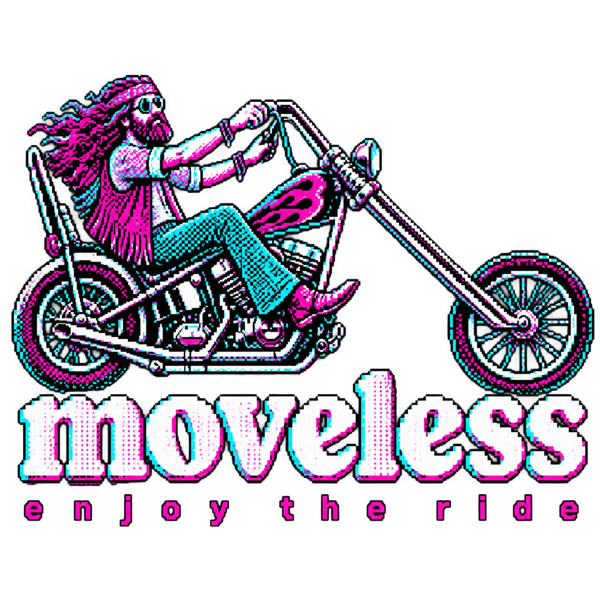

# moveless guide

How to play the moveless module on Ableton Move.

[Русский](../ru/README.md)

## Where to start

- [System overview](overview.md) — what moveless is, and how it all connects
- [The controls](basic-concepts.md) — lanes, pages, patterns, buttons
- [First session](first-session.md) — ten minutes from empty lanes to your own track

## Sound

- [Lane](lane.md) — what every lane shares: page colours, VPCA, euclid, the screen
- [Drums](drums.md) — kick, snare, hat, perc
- [Bass and lead](bass-and-lead.md)
- [Chords](chords.md)
- [Reverb and delay](fx.md) — the green fx lane

## The purple button (aux)

- [Harmony](harmony.md) — the chord progression
- [Global](global.md) — tempo, swing, root, scale, and the rest
- [Macros](macros.md) — eight knobs on every lane at once
- [Mix](mix.md) — glue, pump, wide, tilt

## Playing

- [Journal and sets](scenes.md) — record, copy, delete, switch
- [Transition](transition.md) — a morph between scenes, and Wander
- [Mixer](mixer.md) — levels, mute, solo, lock
- [DJ FX](dj-fx.md) — the performance-effects deck
- [Randomizer](randomize.md) — depth, zone, strength
- [Bookmarks](bookmarks.md)

## Saving

- [Project](project.md) — what is stored, and what comes back when you start
