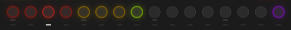
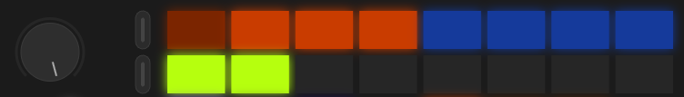
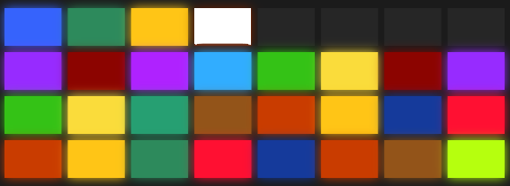
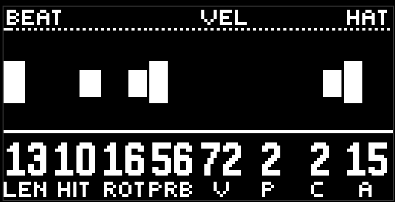
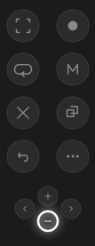

# The controls

moveless is a generative sequencer. It has no grid for entering beats, and no piano roll. Every musical event is set by envelopes. Nothing to be afraid of: this is simpler, and more fun, than the usual way of writing music. Even someone far from music can make their own masterpiece with moveless. Well, at least have an interesting time. That much is certain.

On to the controls.

## Lanes

Along the bottom there is a row of buttons. These switch lanes. One lane holds one instrument.

First come 4 drum lanes (red)

- Kick — the bass drum, the foundation of the groove
- Snare — the snare drum
- Hats — the cymbals
- Perc — percussion in a broad sense, closest of all to toms

Then come 3 melodic lanes (yellow)

- Bass — the bass, the link between rhythm and melody
- Lead — the solo instrument, the main melodic line
- Chords — the chords

Then comes one green lane. This is the effects (fx): a shared reverb and a shared delay.

On the right there is one purple button. This isn't quite an instrument, these are the program settings (the aux lane): harmony, tempo, macros, the bus.

To select a lane, just press its button. The selected lane is marked by a white icon under the lane button.

The lane button itself is alive: while the lane can be heard, it glows at half brightness and flashes on every hit. A muted button, or one pushed down by someone else's solo, goes completely dark, and only the icon under it says it is selected.

If you hold a lane button, its pages appear on the upper rows of pads. This is the same mode as touching the jog, only for the button you are holding. Let go, and you are back on the last page of that lane.

## Pages

Each lane has several pages of parameters. Touch the jog to see every available page on the pads. The page menu takes the top two rows of pads.

You can turn the jog to move between pages. Or just poke a pad, to jump straight to the page you want. Either way, you will see a label on the screen — that is the page title.

The pad colour is the page group. Orange is rhythm and pattern, turquoise is notes, blue is sound, green is the filter and the sends to the effects. The same group is the same colour on every lane, so it's easy to find your way. More about the groups is in the [lane](lane.md) chapter.

If you are already curious, the bottom two rows in page-flipping mode (while you are touching the jog) are the [randomizer](randomize.md) settings.

A jog click latches this view: the pads stay on the pages and the randomizer after the finger is gone. Another click brings the scenes back.

## Patterns and scenes

When you are not holding the jog, the pads are most likely painted in all sorts of colours. This is pattern-select mode.

A pattern is a set of instruments (remember? 4 drums, 3 melodic, and the effects) playing a short musical fragment. A recorded pattern is called a scene, and each scene has its own colour.

You can press  play, and moveless will start playing one of the fragments. The pattern that is playing is marked by its pad blinking white. Press another pad, and moveless starts playing another fragment. Cool? Yes, of course.

Actually it doesn't switch, it glides over: this is called a morph, and how fast it travels is set by the [transition](transition.md). By default it is fast enough that you won't notice, but slow is worth a try.

The module starts already in play. The play button stays lit while the transport is running.

## Knobs

Above the pads are eight encoders. At the bottom of the screen are eight columns: a big number on top, a short name below. An encoder turns its own column.

Touch an encoder without turning it — the full parameter name appears in the header, the column inverts, and the envelope of that parameter is drawn over the notes on the loop picture. Let go, and the picture goes back.

 Shift and a touch of the encoder resets to zero (or to the nearest edge, if zero is off the scale). Handy when you have turned something too far.

Some knobs catch a little on handy values: cycle and ring length on powers of two, bipolar knobs on zero, filter and pitch on the middle. Stay on such a point for half a second, and the next turn goes in the ordinary step.

## What else is on the panel

Just as an overview, so nothing gets forgotten.

On the left:

| | Button | What it does |
|:-:|---|---|
|  | Menu (under the jog) | Switches the pads between the [journal and the set](scenes.md). Lit white in the journal, dark in the set |
|  | Track, four of them | [bookmarks](bookmarks.md). They glow in the colour of the page they remembered |
|  | Play | Transport |
|  | Record | Records the current pattern as a new scene |

On the right:

| | Button | What it does |
|:-:|---|---|
|  | Capture | [dj fx](dj-fx.md) |
|  | Sample | The [transition and wander](transition.md) row on the bottom pads |
|  | Loop | A [randomizer](randomize.md) throw |
|  | Mute | The [mixer](mixer.md) |
|  | Delete | Deleting: with a scene pad, with a lane button, with a bookmark, with minus |
|  | Copy | Copying scenes into a set |
|  | Shift | Modifier |
|  | Plus and minus | Flip journal pages, or switch sets. The module doesn't use the arrows on the sides |

Capture, sample, and mute work the same way: a short press leaves the mode on, a long hold keeps it while the finger is down, and returns when you let go. While the mode is on, the button is lit.

[Guide](README.md)
