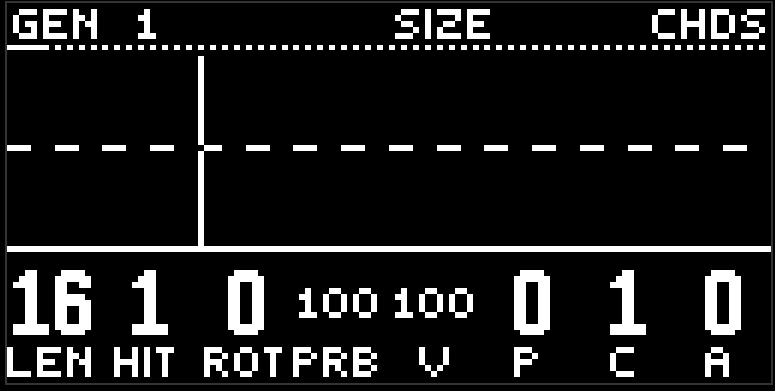
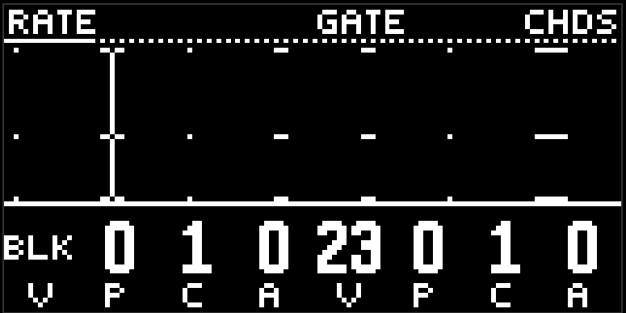

# Chords

The third yellow button. The chords don't choose what to play — that is decided by the [harmony](harmony.md) on the purple button. The chords lane decides how: when to take them, how long to hold them, as a block or as a run through, and with what voice. Thirteen pages in four groups.

## Orange: pattern

**Generator 1** is one euclid: length, hits, rotate, probability. Instead of vel, the fifth knob is **size**. Each hit opens a gap up to the next hit on the ring, and size is how much of that gap to fill with sound: 0 is one sixteenth, 100 is the whole gap. While size is held, the header writes the length of the chunk as a fraction.

**Play** is rate / gate. Rate 0 is a block: every tone of the chord together, held for the length of size. The cell shows BLK. Above zero is an arpeggio: one tone repeats at a rate from 1/1 to 1/64 inside the chunk, and the cell shows the denominator. Gate is the length of each arpeggio note. Gate doesn't cut a block.

**Vel** is vel / prb. The volume of each note, and a second probability threshold. In a block, one throw per hit: the whole chord, or silence. In an arpeggio, a throw per note — that is how a straight run-through turns ragged.

## Turquoise: notes

**Tone / octave**. Tone chooses which chord tone to play in the arpeggio: 0 is the root, 100 is the top. In a block, tone is not read, and the whole stack sounds. Octave is the octave, 0..9, 4 by default. It doesn't decide which note is on the bottom. When the chord has changed, the pitches are worked out in this octave. If you turn octave while the chord is still sounding, all the notes move together: one step of the knob is 12 semitones.

**Spread / flow**. Both knobs are ordinary ones, and they are read on every sixteenth. Spread 0 keeps the notes bunched. 100 lifts the top one by two octaves, and the bottom one stays put. While value is held, the header writes how far the top one has risen: +0, +12, +24. Flow 0 pulls every note along with the root, 100 puts each note as close as it can to the place it was already in. 50 by default. The header writes the biggest jump at this spot. If the phrase has only one chord, it writes 0.

If flow is around 50, a note from the previous chord stays where it is. A new note comes in next to the root, on top. The pitches are remembered when the chord changes, and while it is sounding they are not searched for again.

Tone with a pattern and an amount is the arpeggiator: the shape walks the voice across the tones of the chord.

## Blue: sound

The same five pages as [bass and lead](bass-and-lead.md): attack / sustain, release / flt env, wave / glide, sync / fold, drive / wide. SAMPLE is the first of the blue pages and uses the same GM list, family then program. Each note of a chord reads its own zone of that preset.

Wide is especially useful here: in a block it spreads the copies and makes the pad wide.

## Green: filter and sends

Flt cutoff / flt reso, rev / dly. The chords are the reverb's main customer.

## The screen

The only polyphonic picture: a block draws a row for each tone, an arpeggio draws one row, a rest is empty. This is a piano roll of what actually sounded, probability included.

## Mute

Muted chords stay quiet, but the harmony stays alive: bass and lead with follow still go with the progression. That way you can take the pad out of the mix without losing the melodic link.

## Tips

- One hit per bar, size 100, rate 0 — a pad. One hit, size 100, rate 1/16, tone with a shape — an arpeggio. The same four knobs.
- Hits 4, size around 30, a short gate — stabs.
- Prb around 60 on an arpeggio: the run-through invents a rhythm of its own.

[Guide](README.md)
