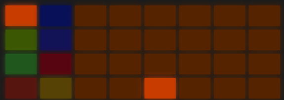

# DJ FX

A performance-effects deck on the master. The  **capture** button. A short press leaves the deck open, a long hold keeps it while the finger is down. While the deck is open, the button is lit. A lane button closes a latched deck.

The deck is a mode, not a page. It takes all 32 pads: scenes are not shown and are not started.

What you do on the deck is not written into a scene, doesn't morph, and doesn't get into record. The deck knobs live in the project.

## Pads

The two left columns are eight groups. The table sits the same way as the pads on the device, and the colours are the same:

<table>
<tr><td> beat repeat</td><td> gate</td></tr>
<tr><td> loop</td><td> pitch</td></tr>
<tr><td> glitch</td><td> tape stop</td></tr>
<tr><td> scratch</td><td> delay throw</td></tr>
</table>

The selected group is lit in its full colour, the rest in a dark shade of their own.

The other 24 pads are the field of the selected group, 4 rows of 6. To the right is more (division, window, time), upward is stronger (variant, shape). The bottom-left corner is the softest and the most direct.

A gesture sounds while a group pad or a field pad is held. Let go, and it stops. Shift latches the gesture, so you can take your hands off. Each group has its own remembered cell, so a group pad plays the last variant straight away.

Stop starts at once. The rest wait for the grid set by the qnt knob.

What is inside the field, by rows from the bottom up:

-  Repeat, retrigger, repeat backwards, back and forth. To the right, the division.
-  Loop, reverse, ping-pong, a stepping loop. To the right, the window length.
-  Shuffle, jump, mangle, cut. To the right, the slice division.
-  Baby, tear, flare, orbit. To the right, the length of the scratch phrase.
-  Half, narrow, mute, and. To the right, the division.
-  Level, rise, fall, rocking. To the right, the speed, the middle is ×1.
-  Stop, speed-up, backspin, stop with a bounce. To the right, the braking time.
-  A quiet send, even, with a tail, hot. To the right, the send stays open longer.

## The screen

Instead of a loop, a stereo groove: the top is the left channel, the bottom is the right. The needle is in the centre. To the left of the needle is what has already sounded, to the right is what is about to arrive. The scale is one bar, and it moves with every tick. A gesture that moves the read position (loop, scratch, stop) moves the picture on the left too.

The header on the left is the group name. On the right, DJ.

## Encoders

The bottom shows the knobs of the selected group. On the right, three fixed places: the field column (div, len, tim, rte, or opn), then qnt, then dep. On the left, the field row and the rest of the group's knobs.

- **Div** is the division, six steps from 1/32 to 1/1.
- **Len** is the loop window, from a sixteenth to a bar.
- **Tim** is the time of the stop and the scratch.
- **Qnt** is the start quant: now, div, beat, bar. Stop has no quant.
- **Dep** is the mix depth of the gesture. Always on the last encoder.
- **Var** is jitter for the scratch, **bat** is the gate width, **bnd** is the direction and the curve, and left of the middle the scratch goes backwards.

Pressing a field cell puts the column and the row onto these knobs. So you can turn it with the knobs, and with the pads.

Every deck knob is more sensitive than an ordinary one: a full travel in two thirds of a turn.

## The tone strip

Turn the jog forward, and the encoders become the tone strip: flt, res, drv, empty, low, mid, hig, dep. Back, and the group knobs return.

- **Flt** is the same filter as on the lanes: 50 is dry, left is high-pass, right is low-pass.
- **Res** is the resonance, home is zero.
- **Drv** is saturation after the filter.
- **Low / mid / hig** is an isolator, detent at 50: zero mutes the band, 100 is about +6 dB.

The tone is heard all the time: both when the group knobs are showing, and when the deck is closed. At the factory it is a bypass. This is your dj mixer on top of everything.

## Delete and loop

 **Delete** on the deck returns the knobs and the field to factory, and the selected group stays.  **Loop** rerolls the visible knobs.

## Tips

- Gat half on the quarters, with qnt beat, is the safest effect on the deck.
- Rpt with shift, and turning div live by hand, is a classic build-up.
- Low down for eight bars, then stp with a bounce, and low back. A drop.
- Thr before a scene change: the throw flies into the delay, and the scene arrives on its tail.

[Guide](README.md)
