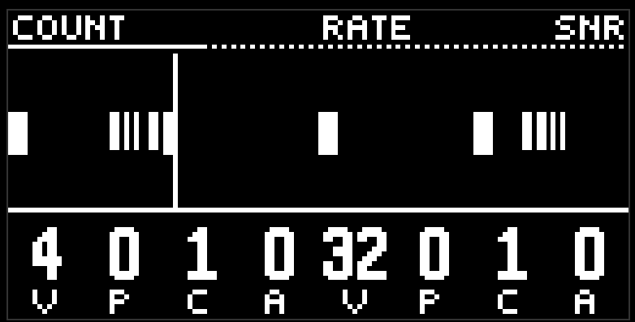

# Drums

Four red buttons: kick, snare, hat, perc. They are built the same way, and they differ in the sound. Eleven pages in three groups.

## Orange: pattern

**Beat gen** is the main groove. Length, hits, rotate, probability, and vel. What beat places are single hits, and they don't break up.

**Roll gen** is the second generator, the same knobs. Its hits unfold into a roll, by the rules of the next two pages. If beat and roll land on the same step, there is one hit, and that hit is a roll.

So the usual setup: beat holds the skeleton, roll adds a roll in two or three places.

**Count / rate** is how the roll breaks up. Count is how many ticks are in the roll (1 is one hit with no roll, and it goes up to eight). Rate is the speed: the cell shows the denominator big, from 8 to 64, and the header writes the whole fraction, triplets included.

**Fade / tone** is the shape of the roll. Both knobs have a detent at 50. Fade below the middle means the roll dies away, above the middle it grows toward the step; while the knob is held, the header writes FALL, FLAT, or RISE. Tone is the pitch tilt along the roll, up to an octave: DOWN, FLAT, UP. The hit on the step itself stays at its own pitch, only the ticks move off it.

## Blue: sound

Four pages, two knobs each. Each drum has its own set.

**Kick**: pitch, decay, bend, bend time, body, click, noise, drive. Bend is how far the pitch falls after the hit, bend time is how long that takes. Body leads the spectrum from a sine to a drumhead, and on to a clip.

**Snare**: pitch, body, body decay, noise, noise decay, snap, tone, drive. Two tails, separate: the body and the wires. Body goes from a single resonator, through an 808/909 pair, to wood, metal, and ring. Snap goes from a long tick to a short bright hit.

**Hat**: pitch, metal, noise, color, decay, attack, reso, pos. Metal goes from noise, to a comb, and on to an inharmonic bank. Pos is the pan, the only one among the drums: 50 is the centre.

**Perc**: pitch, material, decay, bend, fm, ratio, attack, damp. Material is membrane, wood, cavity, bell, metal, digital. Fm and ratio are a second tone in the nord style, with detents on whole intervals. Damp kills the top.

**Sample** is the page after those four. One knob, the other four encoders empty. Zero keeps the drum synthesizer. Above zero is a recording from the drum-machine library, split by the lane: kicks, snares, hats, and everything else. The pitch knob then transposes that recording by up to an octave either way, and 50 plays it at the recorded pitch. Decay, drive, the hat pan, the filter, and the sends still apply.

All of these knobs are a full VPCA, so the timbre can breathe along a motif, or listen to another lane. For example, a kick decay with pattern -2 will shorten on every snare. The sample index is read when the hit lands, so a pattern on SAMPLE picks the recording of the next hit.

## Green: filter and sends

**Flt cutoff / flt reso** is the lane filter. Cutoff at 50 doesn't cut; left is high-pass, right is low-pass. Resonance is silent at zero, and at the top it is acid.

**Rev / dly** is the send to the shared reverb and the shared delay. Zero is dry.

## The screen

On the drums, the loop picture draws pitch vertically too, but the width is the interesting part: one hit is one step, with a small gap between neighbours, so a dense roll doesn't melt into a band.

## Tips

- Probability 70–90 on roll gen and 100 on beat gen: the skeleton stays, the roll comes and goes.
- Different ring lengths on beat and roll (16 and 12, 16 and 10) give a groove that doesn't repeat every bar.
- Vel with a pattern and a small amount on the hat is the cheapest way to bring a beat to life.

[Guide](README.md)
