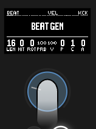
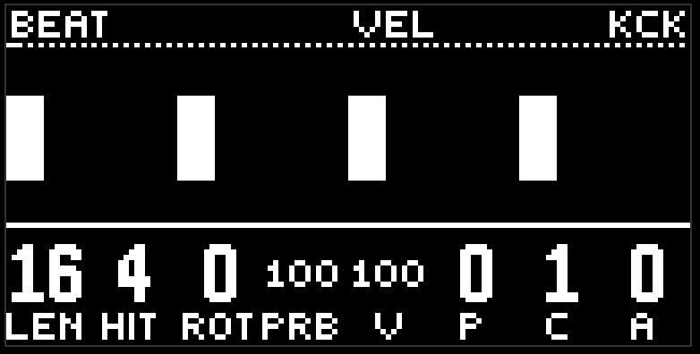
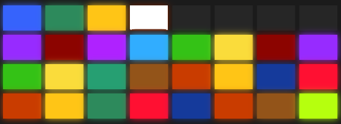

# First session

Ten minutes from the factory project to something you want to record. This is not a manual, this is a route: follow it, and turn aside wherever it gets interesting.

moveless arrives with a set of ready-made scenes in the journal. You can press  play right away and poke the pads — that is the fastest way to hear how it sounds. But here we start from a blank page: hold  shift and press  delete. Every lane is back to factory: minimal sounds, no hit pattern. The scenes in the journal are still there, and you can come back to them at any moment.

## 1. Kick

Press the first red button. This is kick. Touch the jog — the pages light up on the pads. The first orange one is beat gen. Press it.

The first knob is the ring length, the second is the number of hits. Set the length to 16, the hits to 4. Four on the floor, the kick is going. The third knob rotates the figure, the fourth is probability. Leave probability at 100 while you are finding your way.

Four columns have appeared on the loop picture. Those are your hits. The playhead runs across them.

## 2. Hat

The third red button is hat. The same beat gen page: length 16, hits 8. Straight eighths.

Now it gets more interesting. The fifth knob is vel, the volume. It has four parts: v, p, c, a. Turn the last one, amount, up. And then pattern, the second of the four. The hat has started to breathe: the volume walks along a shape. That is the envelope. More in the [lane](lane.md) chapter.

Touch any of the four vel knobs without turning it, and you will see that shape over the loop.

## 3. Snare

The second red button. Length 16, hits 2, rotate 4. The snare on two and four. Classic.

## 4. Bass

The first yellow button. Gen 1: length 16, hits 5, probability 100. The bass is hammering one note — the root. That's normal, it doesn't know anything about the melody yet.

Go to the turquoise pitch page. The first four knobs are pitch: value, pattern, cycle, amount. Value in the middle is the root. Raise amount (the fourth) and turn pattern (the second). The bass has started walking the degrees of the scale. Try cycle (the third): 16 means the shape repeats every bar, 8 means every half bar.

While your finger is on pitch value, the header shows the note instead of the page name: here that is C3, the root in the third octave.

## 5. Chords

The third yellow button. Generator 1: length 16, hits 1. One chord per bar. It is already sounding inside the harmony: the progression is set by the purple button, and the factory one is already stepping.

If you want an arpeggio — the play page, the first knob, rate. Zero is a block, higher is a run through the chord.

## 6. Space

The green fx button. The first page is the reverb, the second is the delay. On their own they stay quiet: you have to send sound there. Go back to snare, the last green page is rev / dly. Raise rev. The snare has gone into the room.

## 7. Recording

Press  record. A colour has lit up on the pad at the bottom left. That is your first scene.

Now turn something for real: a different rotate on the kick, a different pattern on the bass, add a roll on the hat (the roll gen page). Press record again. A second scene, the neighbouring pad to the right.

Your two landed after the ready-made ones, at the end of the wall. The layout is one layout: bricks from the bottom left, and white is the one that is sounding.

## 8. Playing

Press the pad of the first scene. The pattern went back to it. Press the second. It travelled again.

Now press  sample. The bottom row of pads has turned yellow and purple. The yellow ones are the transition speed. Pick slow and press a scene pad again. Listen to the knobs travel for eight bars.

The purple ones are wander. Turn on medium and take your hands off. moveless walks between your scenes by itself.

## 9. While it plays

-  Mute: the mixer opens. The encoders are levels, the top row of pads mutes the lanes.
-  Capture: the dj fx deck opens. Hold any pad on the right-hand field and listen.
-  Loop: a randomizer throw on the current page. If you don't like it, press the scene pad and you are back.
- The purple button, the macro page: eight knobs on every lane at once.

## 10. Leaving

You don't have to do anything. The project saves itself a couple of seconds after every change, and comes back the next time you open the module right where you left it: the same lane, the same page, the same mode.

From here, the chapters of the [guide](README.md).
