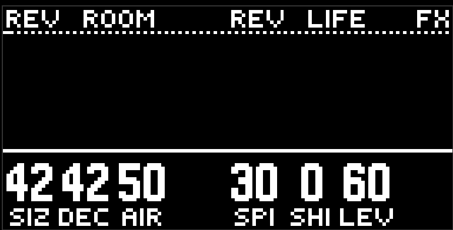
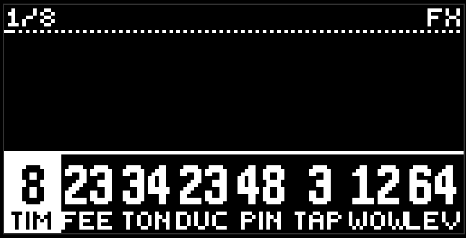

# Reverb and delay

The green button, the eighth step. This is not an instrument, it is two shared effects: one reverb and one delay for everyone. Each lane sends its own share into them with the rev and dly knobs on its own green page.

Two pages, and the knobs are ordinary ones — no pattern, cycle, or amount.

## Reverb

The header says REV ROOM and REV LIFE. On the left: size, decay, air, and the fourth encoder is empty. On the right: spin, shim, level.

- **Size** is the room. Predelay and the early reflections travel with it.
- **Decay** is the tail, from a short room to almost a minute. Size doesn't move it.
- **Air** has a detent in the middle: darker to the left, air to the right.
- **Spin** at zero stands still; higher, and the tail starts to spin, and at the top it is obvious.
- **Shim** at zero is an ordinary plate; higher, and the tail climbs an octave per trip around.
- **Level** is the return, the volume of the reverb in the sum.

## Delay

The header says DLY TIME and DLY ECHO, eight knobs.

- **Time** goes from 1/32 to a bar. The knob is smooth, and the cell shows the nearest note: the denominator big, the whole fraction in the header. The turn doesn't click, the repeats catch the new length smoothly.
- **Feed** is the feedback.
- **Tone** is clean in the middle, darker to the left, thinner to the right.
- **Duck** hides the repeats under a hit, and for about a second after: the first repeat sits behind, the tail comes out after it.
- **Ping** at zero is the centre, higher and the repeats jump from side to side.
- **Taps** is up to three extra hits on the sixteenth grid, next to the main repeat.
- **Wow** at zero is steady, higher and the tape drifts.
- **Level** is the return.

## How this lives with the rest

The fx lane is part of the pattern. Record writes it into the scene, morph slides its knobs, lock holds it in place, the randomizer turns it.

Mute on fx in the mixer silences the wet output and doesn't touch the knobs. fx has no solo of its own, and no fader in the mixer either: the volume is the level knobs.

fx has no loop picture.

## Tips

- A little reverb on everything is better than a lot on one thing. Rev around 15–25 on the snare, the hat, and the chords.
- Delay on the lead with time a bit longer than 1/8 (a dotted eighth) and ping is a classic.
- Duck up to the middle makes the delay audible only in the gaps.

[Guide](README.md)
