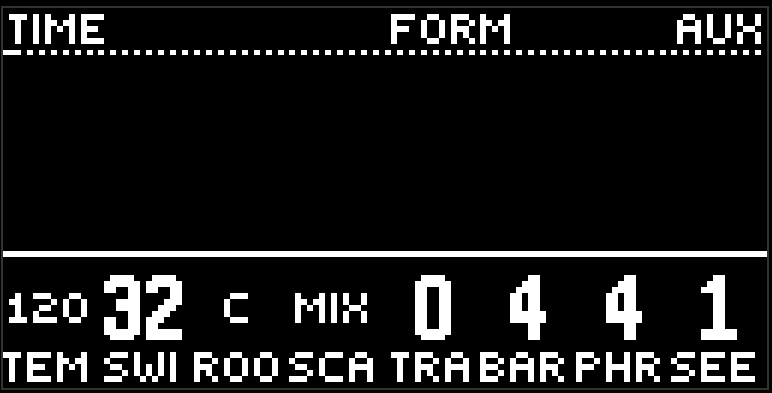

# Global

The second page of the purple button, header GLOBAL, groups TIME and FORM. Settings for the whole project. They are not written into a scene, and they don't travel with a morph.

- **Tempo** is 40..240. The knob is slow, so you can land on a number.
- **Swing** at 0 is straight. Higher, and the odd sixteenths are delayed, at the maximum by half a sixteenth.
- **Root** is the root. The cell shows the note name: C, C#, D...
- **Scale** is the scale. The cell shows MIN, MAJ, DOR, MIX, and the full name is in the header while you touch it.
- **Trans** is transpose, ±24 semitones.
- **Bar** is beats in a bar, 1..16. The meter for everything: transitions, chord lengths, the deck grid.
- **Phrase** is the phrase length in bars, 1..64. That is how long the progression walks before it comes back.
- **Seed** is the grain, 0..999. Every probability is counted from it: the same seed, the same pattern of skips. Turn it if a groove got "stuck" on one version.

## What you hear right away

All of it. Tempo and swing are picked up on the fly, without stopping the transport, root and scale rewrite the note pitch on the next attack, seed changes the probability throws on the next pass.

## The randomizer and delete

This page takes part in the randomizer as ordinary values: depth all and values move it, generators doesn't touch it. Delete in the randomizer with scope page on this page will return everything to factory — tempo included. Keep that in mind.

[Guide](README.md)
