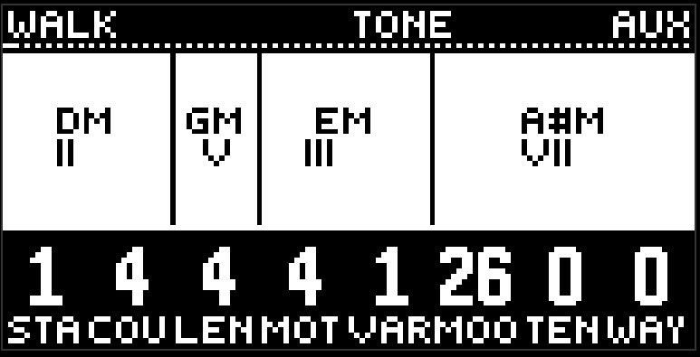

# Harmony

The first page of the purple button, turquoise, header CHORDS. This is the chord progression: which chords, in what order, and for how long. The [chords](chords.md) lane plays it, and bass and lead with follow go along with it.

This matters: the progression is not part of the pattern. Record doesn't write it, morph doesn't touch it, changing scene doesn't replace it. This is a performance control at the project level: you switch scenes, and the harmony stays yours.

Eight knobs:

- **Start** is which degree to begin on, from -7 to +7.
- **Count** is how many chords are in the circle, 0..16. Zero is a special mode, see below.
- **Length** is the length of one chord: a sixteenth, an eighth, a beat, half a bar, a bar.
- **Motion** is how the progression walks the degrees, eight ways.
- **Variation** above zero shortens some of the chords into passing chords, and the neighbour takes the time.
- **Mood** and **tension** are the quality of the chords: from major and minor toward sus, sevenths, diminished, and augmented. One quality for the whole phrase.
- **Way** is the direction and the order of the walk.

On the screen, instead of a loop, there are duration blocks with the chord names. If the root sits in the scale, the degree in roman numerals sits next to it.

## An outside chord

Count 0 means the progression doesn't step. Instead, moveless listens to MIDI on any channel: press a chord on an external keyboard, and that is the harmony for the whole phrase. Let go, and the last set of notes holds. While the count knob is held at zero, the header writes MIDI.

Until the first chord there is no harmony, the chords stay quiet, and bass and lead play the scale.

## Root and scale

The root note and the scale (minor, major, dorian, mixolydian) live on the neighbouring [global](global.md) page. The progression is built inside them.

## Tips

- Count 4, length a bar, motion and way at the factory — a simple square. A good base while you are building the sound.
- Variation 1–2 on a short length gives jazz passing chords.
- The randomizer turns this page like ordinary values. Loop with scope page right on it is a new progression in one press.

[Guide](README.md)
