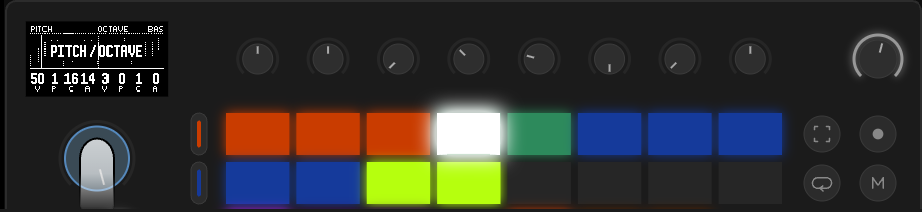
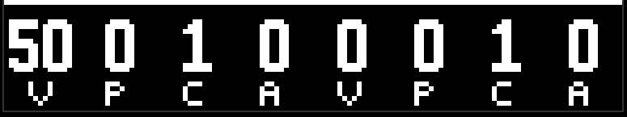
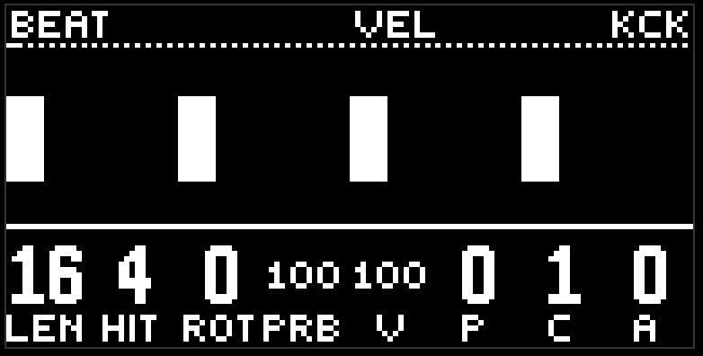

# Lane

Everything the drums, the bass, the lead, and the chords have in common. Read it once, and the instrument chapters after this will be shorter.

## Page groups

The pages of each lane are gathered into groups, and a group has its own pad colour. The colours are the same on every lane.

- **Orange is pattern.** Where the hits sit, and how they break up. Generators, rolls, runs.
- **Turquoise is notes.** Pitch, octave, note length. The drums don't have this group.
- **Blue is sound.** The timbre of the voice. Eight or ten knobs, two to a page.
- **Green is the filter and the sends.** Cutoff and resonance, then the send to the reverb and the delay.

A page is two knobs. But a knob here is not one number, it is four encoders. That is the next section.

## VPCA

Almost every lane parameter is set by four encoders in a row: **v**alue, **p**attern, **c**ycle, **a**mount. On the screen these are four columns, `V`, `P`, `C`, `A`; the name of the parameter itself sits above them in the header. A page is two such fours, eight columns.

- **Value** is the centre. If you don't touch anything else, this is the parameter.
- **Pattern** is the shape. 64 built-in shapes, from a plain saw to torn-up randomness. If you turn it below zero, instead of a shape the parameter starts listening to another lane: -1 kick, -2 snare, -3 hat, -4 perc, -5 bass, -6 lead, -7 chords. Then it repeats that lane's envelope: it flashes on the hit and fades.
- **Cycle** is the period in sixteenths. 16 means the shape fits in a bar. 4 means it repeats every beat. The cycle doesn't depend on the notes, it runs on the grid: the hits just read where the shape is at that moment.
- **Amount** is the depth. Zero means there is no shape, and all you hear is value. The higher it is, the further the parameter steps away from the centre.

Touch any of the four, and the envelope is drawn over the notes on the loop picture, scaled to the loop. The start of each cycle is marked by two pixels along the top. That way you can see where the hits land.

The envelope is read at the moment of the event: a note takes its pitch, volume, and length on its own step. When volume listens to a lane, the picture still draws that shape ahead of time, and the voice follows what that lane has already played. The sound parameters (timbre, filter, sends) the voice reads the whole time the note is sounding, so they drift inside the note.

## Euclid

Every hit on a lane is placed by a euclidean generator. Four knobs:

- **Length** is the ring length in sixteenths. 16 is a bar. 0 means the generator is off.
- **Hits** is how many hits to spread evenly around the ring.
- **Rotate** turns the figure.
- **Probability** is the probability of each hit. 100 is all of them, 0 is silence. The throw is its own for each hit, and it repeats: the same seed, the same figure.

The fifth knob on the same page is **vel**, the volume, a full VPCA.

The drums, the bass, and the lead have two generators. They play at the same time; if both land on one step, there is one hit. The rings can be different lengths: 16 and 12 give a figure that comes back together once every three bars. This is the main source of the liveliness.

The chords have one generator.

## The screen

At the top is the lane name and the page name. Under that, a one-pixel line: at rest it is a dotted line with the sound-engine loading strip on the left, and with a finger on the jog it is a pager, the current page drawn solid.

In the middle is the lane's loop. The width is the whole length of the loop, pitch goes up, time goes across. The height of a column is the volume. For notes, the width is the note length; for hits, it is one step. The playhead runs along the loop by inverting pixels.

At the bottom are eight columns for the eight encoders.

## Gestures

- A short press of a lane button selects it.
- A hold puts the pages on the pads. A pad changes the page, letting go of the button closes the menu.
-  Delete + a lane button returns every knob of that lane to factory. Mute, lock, and the mixer level stay.
-  Shift +  delete is the same thing, but for every lane at once. There is no confirmation, so be careful.
- Mute, solo, and lock for a lane are switched by pads in the [mixer](mixer.md).

**Lock** is an important flag. A locked lane is not touched by morph, wander, the randomizer, or the macros. You got the bass the way you want it, and you want it to stay there while everything else travels — lock it.

## Factory

The factory lane settings are dull on purpose: a minimal sound, zero hits, envelopes at zero. This is a blank page, not a preset. Delete + a lane button brings back exactly that.

[Guide](README.md)
