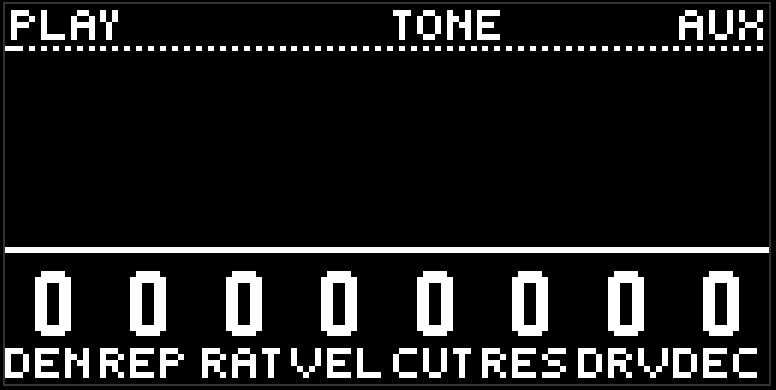

# Macros

The third page of the purple button, header PLAY and TONE. Eight knobs, and each one moves the parameter of the same name on every lane that has it, all at once.

## How this works

A macro is a shift, not a value. The knobs sit at zero. While you hold an encoder and turn it, the shift is added to the parameter value on each lane, and you hear that. Let go of every knob, and each shift you touched is written into the lane values, and the macro goes back to zero (the number on the screen travels there over half a second).

So a macro is a way to turn eight lanes in one movement, and then leave the result in them. Record after you let go writes the new values.

A locked lane ignores the macro. The macros don't touch pattern, cycle, and amount — only value.

## The eight knobs

- **Dens** is density: the probability of the euclidean generators on every lane, including both chord thresholds.
- **Rep** is repeats: repeat on the bass and the lead, the roll count on the drums.
- **Rate** is the speed of the subdivision: the roll rate on the drums, and the arpeggio rate on the chords.
- **Vel** is the volume of the generators and of the chord notes.
- **Cut** is the filter cutoff of each lane.
- **Res** is the resonance of each lane.
- **Drv** is drive on kick, snare, and the melodic lanes.
- **Decay** is decay on kick, hat, perc, both snare tails, and release on the bass, the lead, and the chords.

## What for

- Dens down is a breakdown: every lane thins out. Let go, and it stays that way, and you can record it as a scene.
- Cut down for four bars and back is a filter sweep on the whole mix, but per lane, through the voice filters.
- Decay up on a transition between scenes, so everything smears.

Together with [lock](mixer.md) the macros are especially good: lock the kick and the bass, turn dens, and only the top thins out.

[Guide](README.md)
