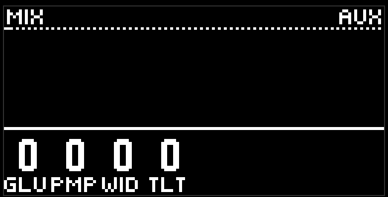
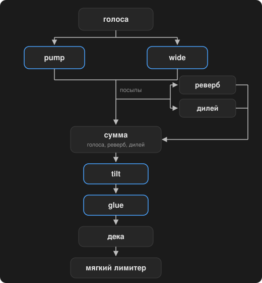

# Mix

The fourth page of the purple button, a blue pad, header MIX. Four knobs on the project's output bus: glue, pump, wide, tilt. Zero on all four is a wire, the sum goes through as it is.

This is not part of the pattern: record doesn't write it, morph doesn't slide it. This is the sound of your project, on top of any scene.

- **Glue** is a compressor on the sum. Attack about 15 ms, release about 150 ms; as the knob goes up, both the ratio and the threshold grow, plus a little makeup. It gathers density.
- **Pump** is a sidechain from the kick: the bass and the chords duck on every kick hit and come back within an eighth of the current tempo.
- **Wide** spreads the chord tones across the stereo, from the bottom one to the top one, opens up the hat pan that is already there, and gives the lead and the perc a short delay on one channel. The kick, the bass, and the snare stay in the centre.
- **Tilt** is one tilt across the whole sum, the join around 1 kHz: darker to the left, brighter to the right.

The order in the chain. The deck is the [dj fx](dj-fx.md) page.

## Tips

- Glue around 30 and pump around 40 is already a "club" character, without extra moves.
- Keep wide moderate: the mono sum stays honest, but on headphones it is easy to overdo it.
- Tilt is a quick way to match the overall brightness to the speakers, without touching the lane filters.

[Guide](README.md)
