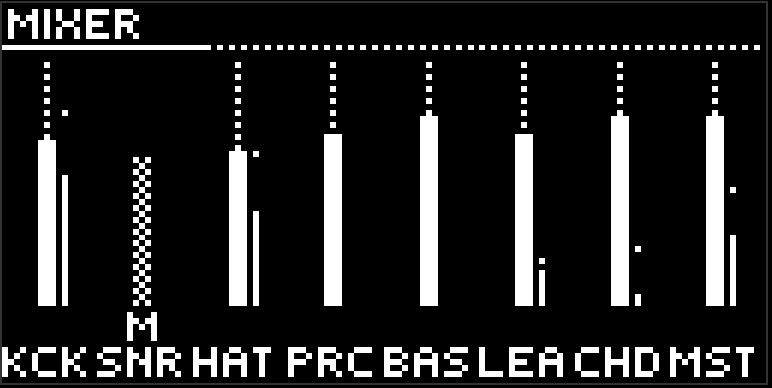
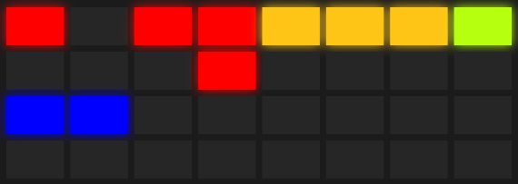

# Mixer

The  **mute** button opens the mixer. A short press leaves it open, a long hold keeps it while the finger is down, then back to where you came from. While the mixer is open, the button is lit white. Pressing any lane button closes a latched mixer.

The mixer is a mode, not a page: it takes the pads and the encoders over completely. The jog doesn't flip pages here.

## The screen

Eight vertical faders: seven lanes and the master. fx has no fader — its volume is the level knobs on its pages.

Next to each fader is a strip: the level and the peak. The peak holds, then falls. Reverb and delay tails show up only on the master.

Under the fader, letters: `M` mute, `S` solo, `L` lock, and at the very bottom a three-letter lane code. A cell over the fader means the lane can't be heard right now: from its own mute, or from someone else's solo.

## Encoders

Eight encoders are eight levels. Turn them. A muted lane feeds neither the reverb nor the delay: silence is silence.

## Pads

The top three rows, seven pads each, left to right like the lane buttons. The eighth column is fx.

- **The top row is mute.** Bright when the lane can be heard, off when it is muted.
- **The second row is solo.** Bright only on the one that is on. Several solos stack; pressing again clears it. While there is at least one solo, only the unmuted solo lanes can be heard. An explicit mute is stronger than solo. fx has no solo.
- **The third row is lock.** Bright on a locked lane.

The bottom row is empty. A pad in the mixer doesn't start a scene.

## Mute, solo, lock

**Mute** takes the lane out of the output. Muted chords still keep feeding harmony to the bass and the lead. Mute on fx silences the wet output and leaves the knobs.

**Solo** is a temporary thing, for setting up or for a performance. Clearing the last solo puts the previous mutes back as they were.

**Lock** is the most useful flag in moveless. A locked lane is not touched by morph, wander, the randomizer, or the macros. It is yours until you take the lock off. Use it to hold the foundation in place and let everything else roam.

Mute, solo, lock, and the levels live in the project, not in the scene. They survive any switch.

## Loop in the mixer

The  loop button here rerolls the fader levels at the randomizer's current strength. It doesn't commit you to anything, and sometimes it is fun.

[Guide](README.md)
