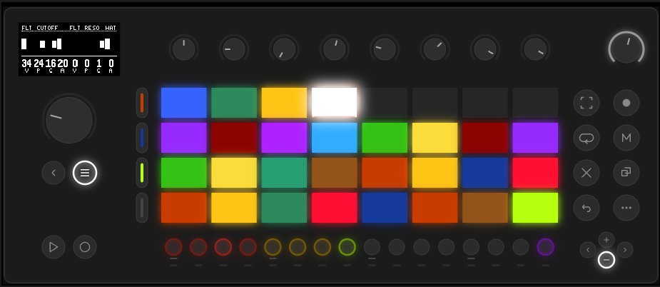

# System overview

moveless is a generative performance sequencer for Ableton Move. It doesn't store notes. It stores the rules that notes appear by, and you play those rules.

This chapter is for anyone who wants to understand the whole picture first, and poke the buttons after. If it's the other way around, go straight to [the controls](basic-concepts.md). You can come back here later.

## What it's made of

Inside moveless there are several layers, and each one sits on the one before it.

**Lane** — one instrument. There are eight: four drums (kick, snare, hat, perc), three melodic ones (bass, lead, chords), and one effects lane (fx). Each lane has its own set of knobs, laid out across pages.

**Pattern** — all eight lanes together. What is playing right now. What you turn when you touch a knob. In the code this is called working, the live document.

**Scene** — a frozen pattern. You pressed record, and the whole current pattern went into memory under its own colour. A scene can't be changed, only deleted. That matters: you will never spoil something you already recorded.

**Journal** — every scene in a row, from old to new. Just a tape of recordings: on the pads they sit in rows, like bricks, from the bottom-left corner upward.

**Set** — a selection of links to scenes in the journal. You can have several sets: one for a live show, another for experiments. A scene in the journal is one scene, and there can be as many links to it as you like.

**Morph** — a move from the current pattern to a chosen scene. You press a scene pad, and the knobs don't jump, they travel to the target over a set time. This is the main gesture of playing.

**Project** — all of it together: the journal, the sets, the mixer, the global settings, the bookmarks. One file, which saves itself and comes back by itself when you turn it on.

## How the sound is born

Each lane plays a loop of sixteenths, round and round. Where the hits sit in that loop is decided by a euclidean generator: ring length, number of hits, rotation, probability. Drums and melodic lanes have two of these generators, and they sit on top of each other.

Everything else — volume, pitch, note length, timbre, filter, sends — is set not by a number, but by an envelope. A knob is a VPCA generator: value, pattern, cycle, and amount. Value is the centre, pattern is the drawing the parameter walks around the centre, cycle is how many sixteenths that drawing takes to repeat, amount is how far it steps away. Amount at zero is an ordinary knob.

Melodic lanes take their notes from the scale, and the scale and the root live in the global settings. A chord progression rides on top of the scale. Bass and lead can listen to it (the follow knob), chords play it directly.

The fx lane is a shared reverb and a shared delay. Each lane sends its own share into them.

The sum goes through the project bus (glue, pump, wide, tilt), then the dj fx deck, then to the output.

## How you play it

The usual working cycle looks like this.

1. Pick a lane, turn the knobs. The pattern changes at once, and you hear it.
2. You like it — press record. A scene of its own colour appears in the journal.
3. Do that a few times. The journal has several scenes.
4. Press the pad of one of them. The pattern travels toward it over the transition time.
5. Press another. It travels toward the other one.
6. Turn wander on. moveless walks the scenes by itself, you only steer.

Between the scenes there are four more performance tools, which are not recorded into a scene and do not morph: the mixer, the macros, dj fx, and the mix bus. They are always on top of whatever is playing.

## What's where on the panel

Along the bottom is a row of sixteen step buttons. The first eight are the lanes. The last one, purple, is settings (aux). The middle is dark.

In the centre are 32 pads. With no finger on the jog they show scenes. With a finger on the jog they show the pages of the selected lane, and the randomizer. In the mixer and in dj fx the pads are taken over by those modes.

Above the pads are eight encoders. They turn the eight columns you see at the bottom of the screen.

The screen is 128×64. At the top, the lane name and the page name, under that a thin line, then the loop picture, and at the bottom eight columns with numbers.

On the left —  [menu](scenes.md) ([journal/set](scenes.md)), four  [track](bookmarks.md) ([bookmarks](bookmarks.md)),  [play](basic-concepts.md),  [record](scenes.md).

On the right —  [capture](dj-fx.md) ([dj fx](dj-fx.md)),  [sample](transition.md) ([transition and wander](transition.md)),  [loop](randomize.md) ([randomize](randomize.md)),  [mute](mixer.md) ([mixer](mixer.md)),  [delete](scenes.md),  [copy](scenes.md),  [shift](basic-concepts.md).

The jog is a wheel: a touch shows the pages, a turn flips through them, a click latches the randomizer.

Each gesture in more detail is in [the controls](basic-concepts.md).

## What moveless doesn't do

So you don't go looking for something that isn't there.

- There is no piano roll and no step sequencer. Notes are not entered by hand.
- There are no samples. Every voice is synthesized inside.
- There is no timeline of its own, and no arrangement. The structure of the track is you and the scenes.
- A scene is not edited. Record a new one, and the old one stays as it was.
- Macros, the mixer, dj fx, and the mix bus are not written into a scene and do not morph.

[Guide](README.md)
