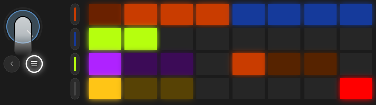

# Randomizer

The  **loop** button is one throw: the knobs in the chosen zone shift at random, with the chosen strength. Again is another throw. The page doesn't change, and you hear the result at once. You don't need a menu for this: the button takes the depth, the zone, and the strength from the pads, even with the jog closed.

What changes, and by how much, is set by the bottom two rows. The pads themselves don't make the throw, they only remember the choice.

## Pads

Touch the jog. The top two rows are the lane's pages, the bottom two are the randomizer settings. A jog click latches this view, a second click brings the scenes back. While it is latched, the [transition row](transition.md) is not drawn.

**The third row is depth and zone.**

Depth, purple, on the left:

<table>
<tr><td align="center"></td><td align="center"></td><td align="center"></td></tr>
<tr><td align="center">envelope values and shapes</td><td align="center">only pattern, cycle, and amount. The values stay</td><td align="center">only the values, follow, the scalars, and the euclid. The shapes stay</td></tr>
</table>

After an empty pad, the zone, orange:

<table>
<tr><td align="center"></td><td align="center"></td><td align="center"></td></tr>
<tr><td align="center">the whole lane</td><td align="center">the group of the current page: pattern, notes, sound, or the filter and the sends. On fx, both pages</td><td align="center">only the knobs of the current page</td></tr>
</table>

**The fourth row is strength, and delete in the right corner.**

Yellow on the left, a red pad on the right:

<table>
<tr><td align="center"></td><td align="center"></td><td align="center"></td><td></td><td align="center"></td></tr>
<tr><td align="center" colspan="3">strength</td><td></td><td align="center">one press returns the chosen zone to factory. The depth is the same as for a throw, and with values the cutoff lands on 50</td></tr>
</table>

The selected pad in each group glows at ordinary brightness, the rest are dim. Pressing any of them writes a name over the choice on the screen for a second: DEPTH over ALL, SCOPE over LANE, INTENSITY over LOW.

The pages in the top rows light up the zone: the ones that will fall under the throw glow bright, the rest are dim.

## Strength

Every knob has a home — the factory value — and a weight. A throw is pulled toward home, not toward the edge of the scale: a step toward home is cheap, a step away from home costs three times as much. So even high rarely takes everything into chaos — it rearranges.

Low can spend the whole budget on one knob. Med, no more than half on one. High, no more than a third, but it touches many.

## Where else loop works

- On the [mixer](mixer.md) — the fader levels.
- On the [deck](dj-fx.md) — the knobs of the open group.
- On the purple button's pages — the progression, global, and mix, as ordinary values. Generators doesn't touch them.

A locked lane doesn't get the throw.

## Tips

- Values + page + low on the beat gen page is the safest way to nudge a groove.
- Generators + group + med on the blue sound group is a new character for the timbre envelopes, on the same notes.
- If you don't like it, press the pad of the current scene. The morph brings everything back over the transition time. On now, right away.
- And the other way around: if you like it, record, before you change your mind.

[Guide](README.md)
