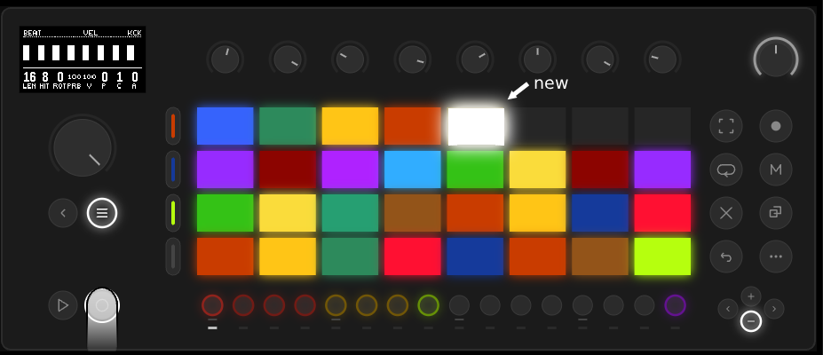
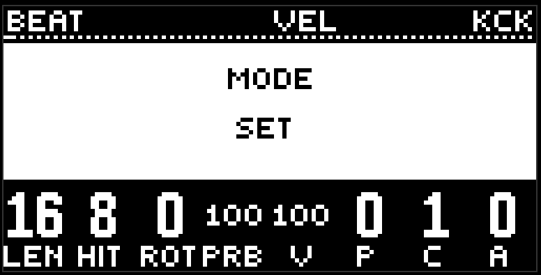
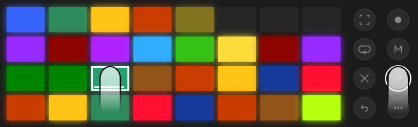

# Journal and sets

A scene is a recorded pattern. The journal is every scene in a row. A set is a selection of links to scenes. This chapter is about how they appear, how they are laid out on the pads, and how they are deleted.

##  Record

Press record (the circle next to play), and the whole current pattern lands in the journal as a new scene. Record never overwrites: every press is a new scene, with its own colour from Move's bright palette.

What goes into a scene: all eight lanes, fx included. What doesn't: the progression, the global settings, the macros, the mixer, the mix bus, the deck. All of that lives in the project and survives a change of scene.

## How the pads sit

Scenes land like bricks. The first one is in the bottom-left corner, the next ones are further right in the same row. When a row has eight, the next one starts a new row above it, from the left again. So the last one you recorded is always in the topmost occupied row, at the far right.

In an empty journal the bottom-left pad pulses dimly: that is the current pattern, not recorded yet, and the first scene will land there.

The active scene pulses between its own colour and white. Empty pads are dark.

There are four rows of pads. While there are fewer rows than that, the wall simply grows from the bottom up. When all four are full, the window shifts: in the journal the top row is always unfinished, and you can see on it where the next brick will stand. If a row already has eight, an empty row is shown on top, with three full ones under it.  **Minus** goes down four rows older, **plus** climbs back up to the newer ones. A button lights white only if there is a page that way. The oldest page always starts with the first brick in the bottom-left corner, so it can partly repeat the neighbouring one.

A set sits the same way, but it has no pages: 32 links are exactly four rows, from the bottom to the top.

## Journal and set

The  **menu** button (under the jog) switches the pads between the journal and the set. In the journal it is lit white, in the set it is dark. Changing mode shows its name on the screen for half a second.

There is one journal. There are many sets: in set mode, plus goes to the next one, minus to the previous one, and there is always one empty set at the tail — that is the one you write a new set into. The direction is the same as in the journal: plus toward the new, minus toward the old. A set holds up to 32 links.

Record in set mode does two things: it writes a scene into the journal, and it immediately puts a link to it in the current set.

##  Copy

Copy gathers scenes into a set.

Hold copy and press pads in the journal — each one is marked with a green pulse. Pressing a pad while copy is held doesn't start the scene. Let go, and the marks stay in the buffer, and the pads glow their own colour again. A new long press of copy starts the list over.

Switch to the set and give copy a short press — the marked ones land in the current set, as many as fit. Ones that are already there are skipped.

A long copy in a set marks links too — that is how you can carry a selection from one set to another.

##  Delete

Delete is always together with something.

- **Delete + a pad in the set** removes the link from the current set. The scene stays in the journal.
- **Delete + a pad in the journal** deletes the scene for good, together with every link to it in every set.
- **Delete + minus** in set mode deletes the set itself.
- **Delete + a lane button** returns the lane to factory. That isn't about scenes, but the gesture is the same.

There are no confirmations. Holding delete is the confirmation.

## Wander and sets

[Wander](transition.md) walks the current set. If the set is empty, it walks the journal. So a set is also a program for the autopilot: put in it only what should sound today.

## Tips

- Record often. Scenes are cheap, the journal flips through, and you can always delete later.
- One set per track, one for drafts. You change them with plus and minus.
- An empty set + wander = wander across the whole journal. Sometimes that is exactly what you want.

[Guide](README.md)
