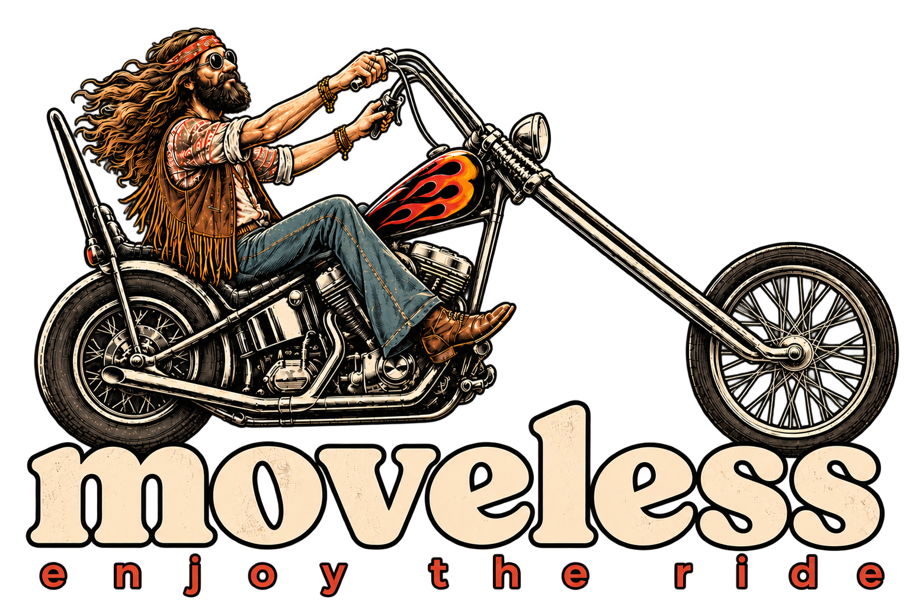

# Руководство moveless

как играть на модуле moveless на Ableton Move.

[English](../en/README.md)

## С чего начать

- [Обзор системы](overview.md) — что такое moveless и как в нём всё связано
- [Основы управления](basic-concepts.md) — дорожки, страницы, паттерны, кнопки
- [Первая сессия](first-session.md) — десять минут от чистых дорожек до своего трека

## Звук

- [Дорожка](lane.md) — что общего у всех дорожек: цвета страниц, VPCA, евклид, экран
- [Ударные](drums.md) — kick, snare, hat, perc
- [Бас и лид](bass-and-lead.md)
- [Аккорды](chords.md)
- [Реверб и дилей](fx.md) — зелёная дорожка fx

## Фиолетовая кнопка (aux)

- [Гармония](harmony.md) — прогрессия аккордов
- [Общие](global.md) — темп, свинг, тоника, лад и остальное
- [Макросы](macros.md) — восемь ручек на все дорожки сразу
- [Микс](mix.md) — glue, pump, wide, tilt

## Игра

- [Журнал и сеты](scenes.md) — записать, скопировать, удалить, переключиться
- [Переход](transition.md) — морф между сценами и Wander
- [Микшер](mixer.md) — уровни, mute, solo, lock
- [DJ FX](dj-fx.md) — дека перформанс-эффектов
- [Рандомизатор](randomize.md) — глубина, зона, сила
- [Закладки](bookmarks.md)

## Сохранение

- [Проект](project.md) — что хранится и что поднимается при старте
