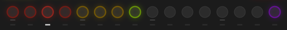
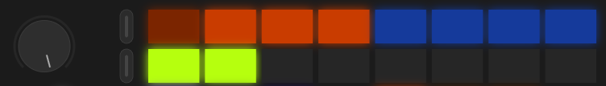
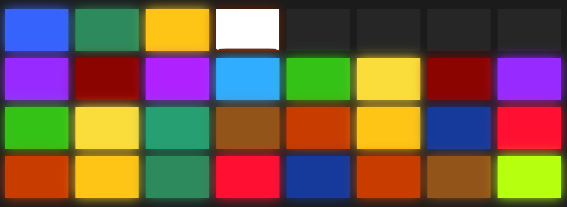
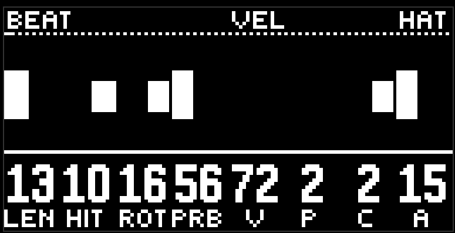
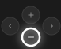
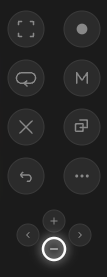

# Основы управления

moveless - генеративный секвенсер. у него нет сетки для ввода битов или пьяно ролла. все музыкальные события задаются огибающими. бояться нечего, это проще и прикольнее, чем стандартный подход к написанию музыки. даже человек, далёкий от музыки, может создать с помощью moveless свой шедевр. ну, хотя бы интересно провести время. это точно.

перейдём к основам управления.

## Дорожки

снизу есть ряд кнопок, это переключатели дорожек. на одной дорожке размещён один инструмент.

сначала идут 4 дорожки ударных (красные)

- kick - бочка, основа грува
- snare - рабочий барабан
- hats - тарелки
- perc - перкуссия в широком смысле, больше всего похожа на томы

потом идут 3 мелодических дорожки (жёлтые)

- bass - бас, связующее звено между ритмом и мелодией
- lead - соло-инструмент, главная мелодическая линия
- chords - аккорды

далее идёт одна зелёная дорожка. это эффекты (fx): общий реверб и общий дилей.

справа есть одна фиолетовая кнопка. это не совсем инструмент, это настройки программы (aux дорожка): гармония, темп, макросы, шина.

чтобы выбрать дорожку, просто нажмите на её кнопку. выбранная дорожка отмечена белой иконкой под кнопкой дорожки.

сама кнопка дорожки живёт: пока дорожку слышно, она горит вполсилы и вспыхивает на каждом ударе. замьюченная или задавленная чужим solo кнопка гаснет совсем, и о выборе говорит только иконка под ней.

если удерживать кнопку дорожки, на верхних рядах пэдов появятся её страницы. это тот же режим, что при касании джога, только для той кнопки, которую держите. отпустите - вернётесь на последнюю страницу этой дорожки.

## Страницы

у каждой дорожки есть несколько страниц параметров. прикоснитесь к джогу, чтобы увидеть на пэдах все доступные страницы. меню страниц занимают верхние две строчки пэдов.

вы можете поворачивать джог, чтобы перемещаться между страницами. или прямо тыкнуть на пэд, чтобы сразу быстро перейти к нужной странице. в любом случае на экране вы увидите подпись - это заголовок страницы.

цвет пэда - это группа страницы. оранжевый - ритм и паттерн, бирюзовый - ноты, голубой - звук, зелёный - фильтр и посылы на эффекты. одна и та же группа одного цвета на любой дорожке, так что ориентироваться легко. подробнее про группы - в главе [дорожка](lane.md).

если вам уже любопытно, то две нижние строки в режиме перелистывания страниц (когда вы касаетесь джога) занимают настройки [рандомизатора](randomize.md).

клик джога защёлкивает этот вид: пэды остаются на страницах и рандомизаторе, когда палец убран. ещё клик возвращает сцены.

## Паттерны и сцены

когда вы не держитесь за джог, то пэды скорее всего пёстро раскрашены в разные цвета. это режим выбора паттерна.

паттерн - это набор инструментов (помните? 4 ударных, 3 мелодических, и эффекты), играющих небольшой музыкальный фрагмент. записанный паттерн называется сценой, и у каждой сцены свой цвет.

можете нажать  play, и moveless начнёт воспроизводить один из фрагментов. проигрываемый паттерн отмечается миганием пэда в белый цвет. нажмите на другой пэд, и moveless начнёт играть другой фрагмент. круто? конечно да!

на самом деле он не переключается, а плавно переезжает: это называется морф, и как быстро он едет, задаёт [переход](transition.md). по умолчанию достаточно быстро, чтобы вы этого не заметили, но стоит попробовать slow.

модуль стартует сразу в play. кнопка play горит, пока транспорт идёт.

## Ручки

над пэдами восемь энкодеров. внизу экрана восемь колонок: крупная цифра сверху, короткое имя снизу. энкодер крутит свою колонку.

коснитесь энкодера, не вращая - в шапке появится полное имя параметра, колонка инвертируется, а на картинке петли поверх нот нарисуется огибающая этого параметра. отпустите - картинка вернётся.

 shift и касание энкодера - сброс в ноль (или в ближайшую границу, если ноль вне шкалы). удобно, когда накрутили лишнего.

некоторые ручки чуть цепляются за удобные значения: цикл и длина кольца за степени двойки, двуполярные ручки за ноль, фильтр и высота за середину. постояли на такой точке полсекунды - следующий поворот идёт обычным шагом.

## Что ещё есть на панели

просто в качестве обзора, чтобы ничего не забыть.

слева:

| | кнопка | что делает |
|:-:|---|---|
|  | menu (под джогом) | переключает пэды между [журналом и сетом](scenes.md). горит белым в журнале, погашена в сете |
|  | track, четыре штуки | [закладки](bookmarks.md). горят цветом страницы, которую запомнили |
|  | play | транспорт |
|  | record | записывает текущий паттерн как новую сцену |

справа:

| | кнопка | что делает |
|:-:|---|---|
|  | capture | [dj fx](dj-fx.md) |
|  | sample | ряд [перехода и wander](transition.md) на нижних пэдах |
|  | loop | бросок [рандомизатора](randomize.md) |
|  | mute | [микшер](mixer.md) |
|  | delete | удаление: с пэдом сцены, с кнопкой дорожки, с закладкой, с минусом |
|  | copy | копирование сцен в сет |
|  | shift | модификатор |
|  | плюс и минус | листают страницы журнала или переключают сеты. стрелки по бокам модуль не использует |

capture, sample и mute работают одинаково: короткое нажатие оставляет режим включённым, долгое удержание держит его, пока палец лежит, и возвращает обратно при отпускании. пока режим включён, кнопка горит.

[Руководство](README.md)
