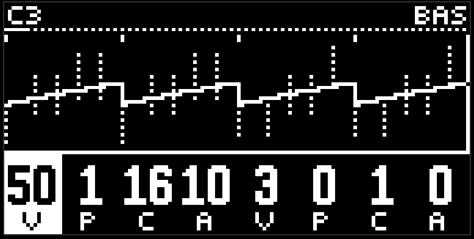
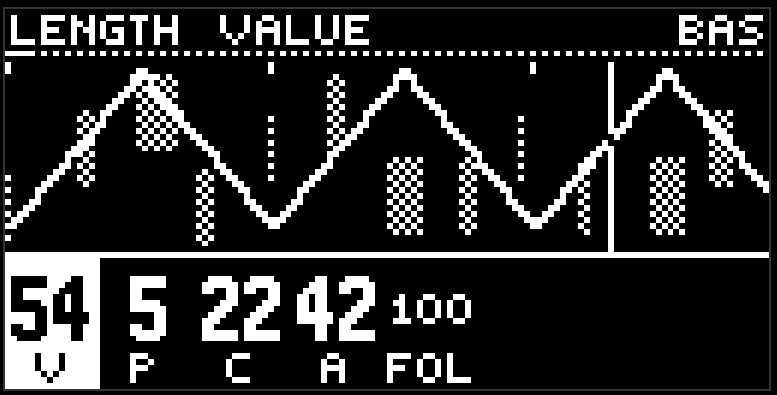

# Бас и лид

две жёлтые кнопки, один и тот же инструмент на разной высоте. бас по умолчанию в третьей октаве, лид в четвёртой. двенадцать страниц в четырёх группах, вторая строка страниц уходит на второй ряд пэдов.

## Оранжевые: паттерн

**generator 1** и **generator 2** - два евклида, те же length, hits, rotate, probability и vel. генератор 1 ставит одиночные ноты. генератор 2 ставит ноты, которые могут развернуться в прогон. совпали - одна нота, и это прогон.

**repeat / span** - прогон. repeat (count) - на сколько равных частей делится длина ноты: 1 - одна нота, дальше до восьми. span - куда прогон едет: середина - никуда, края - на семь ступеней гаммы вверх или вниз за весь проход. первая доля остаётся на pitch, последняя уходит на span.

это не ролл ударных: прогон делит ноту, а не сетку, и ходит по ступеням.

## Бирюзовые: ноты

**pitch / octave**. pitch 50 - тоника выбранной гаммы, края - две октавы гаммы в стороны. пока ручка зажата, шапка пишет имя ноты. octave - абсолютная октава, 0..9, и просто сдвигает это окно. ступень и октава складываются.

**length / follow**. length - длина ноты. follow - насколько нота слушает [гармонию](harmony.md): 0 - остаётся в гамме, 100 - садится на ближайший тон звучащего аккорда. бас с follow 100 всегда идёт за прогрессией. лид с follow 50 иногда соглашается, иногда нет.

все пять - полный VPCA. мелодия в moveless - это pitch с рисунком. pattern задаёт контур, cycle - за сколько он повторяется, amount - насколько широко.

## Голубые: звук

пять страниц по две ручки, одинаковые у баса, лида и аккордов. голос - унисонный волновой стол.

- **wave / glide**. wave едет от тёмного тона через треугольник, пилу, квадрат к гласному. glide - портаменто: ноль - скачок, выше высота догоняет цель.
- **sync / fold**. жёсткая синхронизация и фолд. оба на нуле ничего не делают.
- **drive / wide**. drive - мягкий клип. wide - две боковые копии, расстроенные в стороны: хорус без потери громкости.
- **attack / sustain**. attack - доля длины ноты до пика. sustain - громкость к концу ноты: 0 - плак, 1 - полка.
- **release / flt env**. release - хвост после конца ноты. env - насколько фильтр открывается на атаке и закрывается к концу ноты.

огибающая громкости привязана к длине ноты: длинная нота - длинная атака, короткая - короткая. короткий length и высокий release - стэб.

## Зелёные: фильтр и посылы

как у всех: flt cutoff / flt reso, потом rev / dly. cutoff на 50 прозрачен, влево high-pass, вправо low-pass.

## Экран

нота в петле - полоска: высота по вертикали, ширина - length. если нота выходит за конец петли, хвост переносится в начало. бас и лид монофоничны: в одной шестнадцатой одна нота.

## Советы

- пустой бас: gen 1 с 16/5, pitch amount около 30 с коротким циклом и follow 100. уже музыка.
- лид на другом кольце (12 или 10) относительно баса даёт фразы, которые не кончаются вместе с тактом.
- repeat 3–4 с span вниз на нескольких нотах gen 2 - готовый филл.
- cutoff с pattern -1 и небольшим amount: фильтр приоткрывается на каждую бочку.

[Руководство](README.md)
