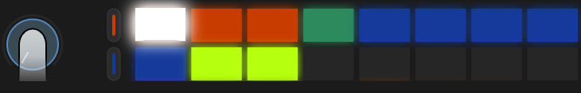
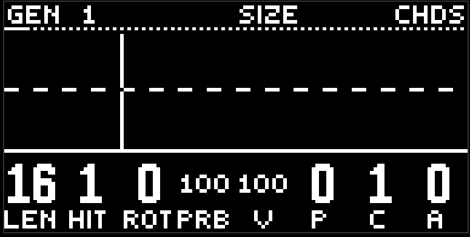
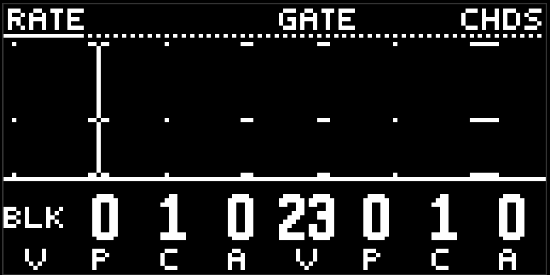

# Аккорды

третья жёлтая кнопка. аккорды не выбирают, что играть - это решает [гармония](harmony.md) на фиолетовой кнопке. дорожка chords решает, как: когда брать, сколько держать, блоком или перебором, каким голосом. одиннадцать страниц в четырёх группах.

## Оранжевые: паттерн

**generator 1** - один евклид: length, hits, rotate, probability. вместо vel пятая ручка - **size**. каждый хит открывает дырку до следующего хита кольца, size - какую её долю заполнить звуком: 0 - одна шестнадцатая, 100 - всю дырку. пока size зажат, шапка пишет длину куска как дробь.

**play** - rate / gate. rate 0 - блок: все тоны аккорда вместе, держится на длину size. в клетке BLK. выше нуля - арпеджио: один тон повторяется с частотой от 1/1 до 1/64 внутри куска, в клетке знаменатель. gate - длина каждой ноты арпеджио. блок gate не режет.

**vel** - vel / prb. громкость каждой ноты и второй порог вероятности. в блоке один бросок на хит: аккорд целиком или тишина. в арпеджио бросок на каждую ноту - так из ровного перебора получается рваный.

## Бирюзовые: ноты

**tone / octave**. tone выбирает, какой тон аккорда играть в арпеджио: 0 - корень, 100 - верхний. в блоке tone не читается, звучит весь стек. octave - абсолютная октава, 0..9, по умолчанию 4; блок держит все тоны внутри неё, так что ходьба корня не разваливает фактуру.

tone с pattern и amount - это и есть арпеджиатор: рисунок водит голос по тонам аккорда.

## Голубые: звук

те же пять страниц, что у [баса и лида](bass-and-lead.md): wave / glide, sync / fold, drive / wide, attack / sustain, release / flt env.

wide здесь особенно полезен: в блоке он разводит копии и делает пэд широким.

## Зелёные: фильтр и посылы

flt cutoff / flt reso, rev / dly. аккорды - главный клиент реверба.

## Экран

единственная полифоническая картинка: блок рисует строку на каждый тон, арпеджио - одну строку, пауза пустая. это пиано-ролл того, что реально прозвучало, с учётом вероятности.

## Mute

замьюченные аккорды молчат, но гармония живёт: бас и лид с follow по-прежнему идут за прогрессией. так можно убрать пэд из микса, не теряя мелодической связи.

## Советы

- один хит на такт, size 100, rate 0 - пэд. один хит, size 100, rate 1/16, tone с рисунком - арпеджио. те же четыре ручки.
- hits 4, size около 30, gate короткий - стабы.
- prb около 60 на арпеджио: перебор сам придумывает ритм.

[Руководство](README.md)
