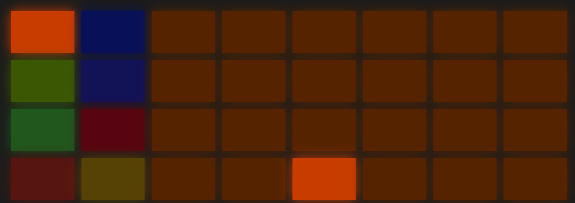
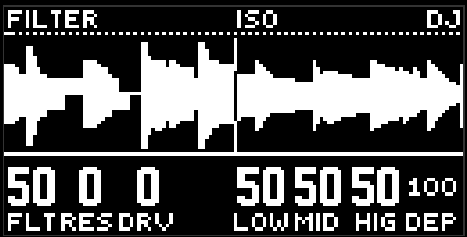

# DJ FX

дека перформанс-эффектов на мастере. кнопка  **capture**. короткое нажатие оставляет деку, долгое удержание держит её, пока палец лежит. пока дека открыта, кнопка горит. кнопка дорожки закрывает защёлкнутую деку.

дека - режим, не страница. она забирает все 32 пэда: сцены не показываются и не запускаются.

то, что вы делаете на деке, не пишется в сцену, не морфится и не попадает в record. ручки деки живут в проекте.

## Пэды

две левые колонки - восемь групп. таблица стоит так же, как пэды на устройстве, цвета те же:

<table>
<tr><td> beat repeat</td><td> гейт</td></tr>
<tr><td> петля</td><td> высота</td></tr>
<tr><td> глитч</td><td> стоп ленты</td></tr>
<tr><td> скретч</td><td> бросок в дилей</td></tr>
</table>

выбранная группа горит полным цветом, остальные - тёмным оттенком своего.

остальные 24 пэда - поле выбранной группы, 4 ряда по 6. вправо больше (деление, окно, время), вверх сильнее (вариант, форма). левый нижний угол - самое мягкое и прямое.

жест звучит, пока зажат пэд группы или пэд поля. отпустили - перестал. shift фиксирует жест, чтобы убрать руки. у каждой группы своя запомненная клетка, так что пэд группы сразу играет последний вариант.

стоп стартует сразу. остальные ждут сетку, заданную ручкой qnt.

что внутри поля, по рядам снизу вверх:

-  повтор, ретриггер, повтор задом, туда-обратно. вправо - деление.
-  петля, реверс, пинг-понг, шагающая петля. вправо - длина окна.
-  shuffle, jump, mangle, cut. вправо - деление ломтиков.
-  baby, tear, flare, orbit. вправо - длина фразы скретча.
-  half, narrow, mute, and. вправо - деление.
-  ровно, подъём, спад, качание. вправо - скорость, середина ×1.
-  стоп, разгон, бэкспин, стоп с отскоком. вправо - время торможения.
-  тихий посыл, ровный, с хвостом, горячий. вправо - дольше открыт посыл.

## Экран

вместо петли - стереоканавка: верх левый канал, низ правый. игла по центру. слева от иглы - то, что уже прозвучало, справа - что сейчас придёт. масштаб один такт, едет с каждым тиком. жест, который двигает чтение (петля, скретч, стоп), двигает и картинку слева.

шапка слева - имя группы. справа - DJ.

## Энкодеры

низ показывает ручки выбранной группы. справа три постоянных места: колонка поля (div, len, tim, rte или opn), затем qnt, затем dep. слева ряд поля и остальные ручки группы.

- **div** - деление, шесть шагов от 1/32 до 1/1.
- **len** - окно петли от шестнадцатой до такта.
- **tim** - время стопа и скретча.
- **qnt** - квант старта: now, div, beat, bar. у стопа кванта нет.
- **dep** - глубина микса жеста. всегда на последнем энкодере.
- **var** - дрожь скретчу, **dut** - ширина гейта, **bnd** - направление и кривая, левее середины скретч назад.

нажатие клетки поля ставит колонку и ряд на эти ручки. так что крутить можно и ручками, и пэдами.

все ручки деки чувствительнее обычных: полный ход за две трети оборота.

## Полоса тона

поверните джог вперёд - энкодеры станут полосой тона: flt, res, drv, пусто, low, mid, hig, dep. назад - вернутся ручки группы.

- **flt** - тот же фильтр, что у дорожек: 50 сухо, влево high-pass, вправо low-pass.
- **res** - резонанс, дом ноль.
- **drv** - насыщение после фильтра.
- **low / mid / hig** - изолятор, засечка на 50: ноль глушит полосу, 100 около +6 дБ.

тон слышен всегда: и когда показаны ручки группы, и когда дека закрыта. на заводе он обход. это ваш dj-микшер поверх всего.

## Delete и loop

 **delete** на деке возвращает ручки и поле к заводу, выбранная группа остаётся.  **loop** рероллит видимые ручки.

## Советы

- gat half на четвертях с qnt beat - самый безопасный эффект на деке.
- rpt с shift и поворот div ручкой вживую - классический билд-ап.
- low вниз на восемь тактов, потом stp с отскоком и low обратно. дроп.
- thr перед сменой сцены: бросок улетает в дилей, сцена приходит на его хвосте.

[Руководство](README.md)
