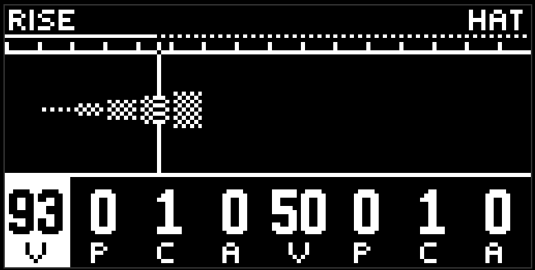
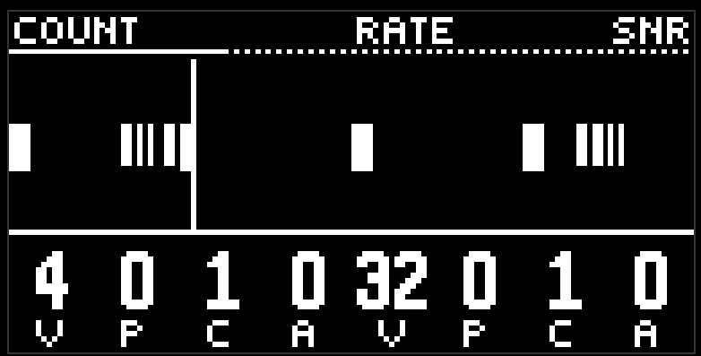

# Ударные

четыре красные кнопки: kick, snare, hat, perc. устроены одинаково, различаются звуком. десять страниц в трёх группах.

## Оранжевые: паттерн

**beat gen** - основной грув. length, hits, rotate, probability и vel. то, что ставит beat, - одиночные удары, они не дробятся.

**roll gen** - второй генератор, те же ручки. его удары разворачиваются в дробь по правилам двух следующих страниц. если beat и roll попали в один шаг, удар один, и это ролл.

так что типичная схема: beat держит скелет, roll в двух-трёх местах добавляет дробь.

**count / rate** - как дробится ролл. count - сколько тиков в дроби (1 - один удар без дроби, дальше до восьми). rate - частота: клетка показывает знаменатель крупно, от 8 до 64, шапка пишет дробь целиком, включая триоли.

**fade / tone** - форма дроби. обе ручки с засечкой на 50. fade ниже середины - дробь затухает, выше - нарастает к шагу; пока ручка зажата, шапка пишет FALL, FLAT или RISE. tone - наклон высоты вдоль дроби, до октавы: DOWN, FLAT, UP. удар на самом шаге остаётся на своей высоте, уходят только тики.

## Голубые: звук

четыре страницы по две ручки. у каждого барабана свой набор.

**kick**: pitch, decay, bend, bend time, body, click, noise, drive. bend - сколько высота падает после удара, bend time - за сколько. body ведёт спектр от синуса к мембране и дальше к клипу.

**snare**: pitch, body, body decay, noise, noise decay, snap, tone, drive. два хвоста отдельно: тело и проволока. body от одного резонатора через пару 808/909 к дереву, металлу и ring. snap - от долгого тика к короткому яркому удару.

**hat**: pitch, metal, noise, color, decay, attack, reso, pos. metal - от шума к гребёнке и негармоническому банку. pos - панорама, единственная среди ударных: 50 по центру.

**perc**: pitch, material, decay, bend, fm, ratio, attack, damp. material - мембрана, дерево, полость, колокол, металл, цифра. fm и ratio - второй тон в стиле nord, с полками на целых интервалах. damp гасит верх.

все эти ручки - полный VPCA, так что тембр может дышать по мотиву или слушать другую дорожку. например, decay бочки с pattern -2 будет укорачиваться на каждый снейр.

## Зелёные: фильтр и посылы

**flt cutoff / flt reso** - фильтр дорожки. cutoff на 50 не режет; влево high-pass, вправо low-pass. резонанс на нуле молчит, наверху кислота.

**rev / dly** - посыл в общий реверб и общий дилей. ноль - сухо.

## Экран

у ударных картинка петли тоже рисует высоту по вертикали, но интереснее ширина: один удар - один шаг, между соседними маленький зазор, чтобы плотный ролл не слипался в полосу.

## Советы

- вероятность 70–90 на roll gen и 100 на beat gen: скелет стоит, дробь приходит и уходит.
- разная длина колец у beat и roll (16 и 12, 16 и 10) даёт грув, который не повторяется каждый такт.
- vel с pattern и небольшим amount на хэте - самый дешёвый способ оживить бит.

[Руководство](README.md)
