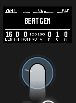
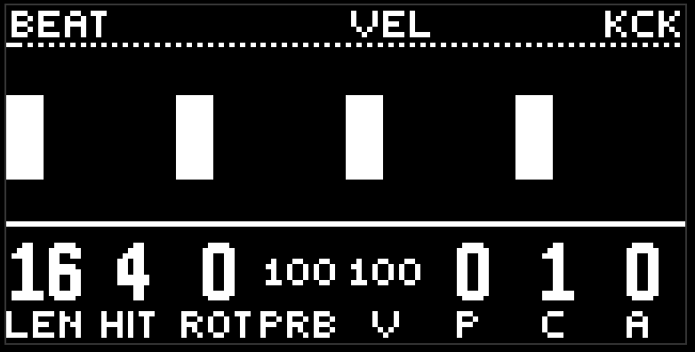
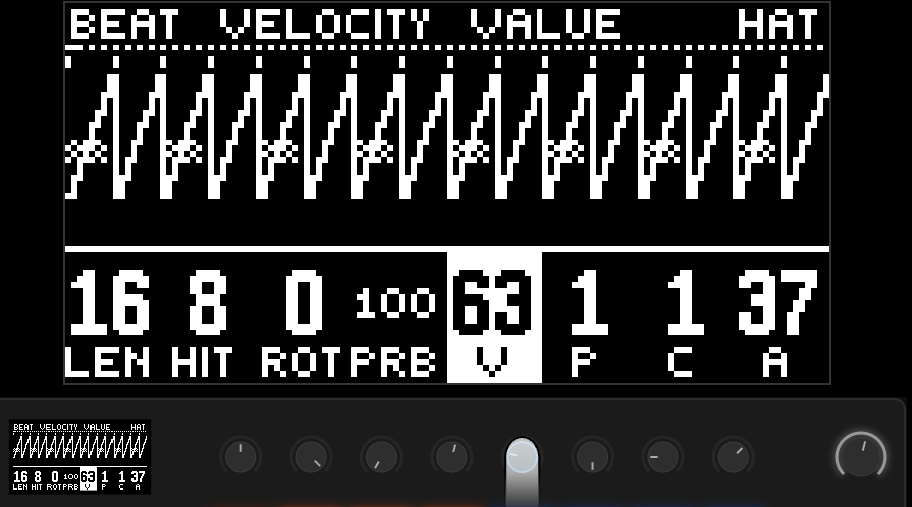
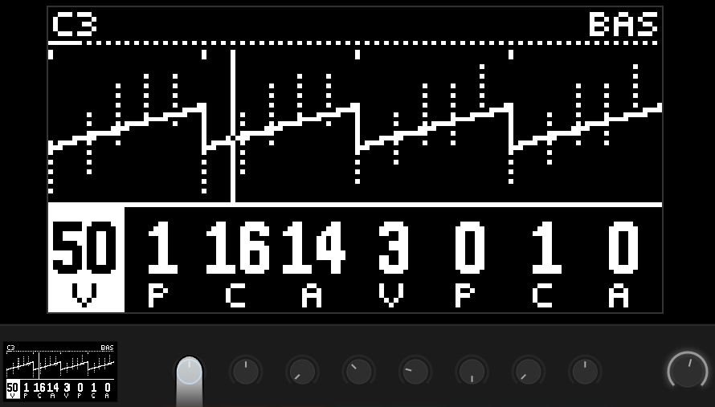

# Первая сессия

десять минут от заводского проекта до чего-то, что хочется записать. это не инструкция, это маршрут: идите по нему, сворачивайте где интересно.

ptnmove приходит с набором готовых сцен в журнале. можно сразу нажать  play и потыкать пэды - это самый быстрый способ понять, как оно звучит. но здесь мы пойдём с чистого листа: зажмите  shift и нажмите  delete. все дорожки вернулись к заводу: минимальные звуки, без рисунка ударов. сцены в журнале при этом никуда не делись, к ним можно вернуться в любой момент.

## 1. Бочка

нажмите первую красную кнопку. это kick. коснитесь джога - на пэдах загорелись страницы. первая оранжевая - beat gen. нажмите её.

первая ручка - длина кольца, вторая - число ударов. поставьте длину 16, ударов 4. четыре на четыре, бочка пошла. третья ручка поворачивает рисунок, четвёртая - вероятность. оставьте вероятность на 100, пока разбираетесь.

на картинке петли появились четыре столбика. это ваши удары. плейхед бежит по ним.

## 2. Хэт

третья красная кнопка - hat. та же страница beat gen: длина 16, ударов 8. ровные восьмые.

теперь интереснее. пятая ручка - vel, громкость. у неё четыре части: v, p, c, a. покрутите последнюю, amount, вверх. а потом pattern - вторую из четырёх. хэт начал дышать: громкость гуляет по рисунку. это и есть огибающая. подробнее в главе [дорожка](lane.md).

коснитесь любой из четырёх ручек vel, не вращая - и увидите этот рисунок поверх петли.

## 3. Снейр

вторая красная кнопка. длина 16, ударов 2, поворот 4. снейр на вторую и четвёртую. классика.

## 4. Бас

первая жёлтая кнопка. gen 1: длина 16, ударов 5, вероятность 100. бас задолбил одну ноту - тонику. это нормально, он пока ничего не знает о мелодии.

перейдите на бирюзовую страницу pitch. первые четыре ручки - это pitch: value, pattern, cycle, amount. value на середине - тоника. поднимите amount (четвёртую) и покрутите pattern (вторую). бас начал ходить по ступеням гаммы. попробуйте cycle (третью): 16 - рисунок повторяется каждый такт, 8 - каждые полтакта.

пока палец на pitch value, шапка вместо имени страницы показывает ноту: здесь это C3, тоника в третьей октаве.

## 5. Аккорды

третья жёлтая кнопка. generator 1: длина 16, ударов 1. один аккорд на такт. он уже звучит в гармонии: прогрессию задаёт фиолетовая кнопка, и заводская там уже шагает.

хочется арпеджио - страница play, первая ручка rate. ноль - блок, выше - перебор.

## 6. Пространство

зелёная кнопка fx. первая страница - реверб, вторая - дилей. но сами по себе они молчат: нужно послать туда звук. вернитесь на snare, последняя зелёная страница - rev / dly. поднимите rev. снейр ушёл в комнату.

## 7. Запись

нажмите  record. на пэде слева внизу загорелся цвет. это ваша первая сцена.

теперь покрутите что-нибудь существенно: другой rotate у бочки, другой pattern у баса, добавьте roll на хэт (страница roll gen). нажмите record ещё раз. вторая сцена, соседний пэд справа.

ваши две легли следом за готовыми, в конец стены. раскладка одна: кирпичами снизу слева, белая - та, что звучит.

## 8. Игра

нажмите пэд первой сцены. паттерн вернулся к ней. нажмите вторую. снова поехал.

теперь нажмите  sample. нижний ряд пэдов стал жёлто-фиолетовым. жёлтые - скорость перехода. выберите slow и снова нажмите пэд сцены. слушайте, как ручки едут восемь тактов.

фиолетовые - wander. включите medium и уберите руки. ptnmove сам ходит между вашими сценами.

## 9. Пока оно играет

-  mute: откроется микшер. энкодеры - уровни, верхний ряд пэдов - мьют дорожек.
-  capture: откроется дека dj fx. зажмите любой пэд правого поля и слушайте.
-  loop: бросок рандомизатора по текущей странице. не понравилось - нажмите пэд сцены, вернётесь.
- фиолетовая кнопка, страница macro: восемь ручек на все дорожки сразу.

## 10. Выход

ничего делать не надо. проект сам сохраняется через пару секунд после каждого изменения и поднимается при следующем открытии модуля там же, где вы его оставили: та же дорожка, та же страница, тот же режим.

дальше - по главам [руководства](README.md).
