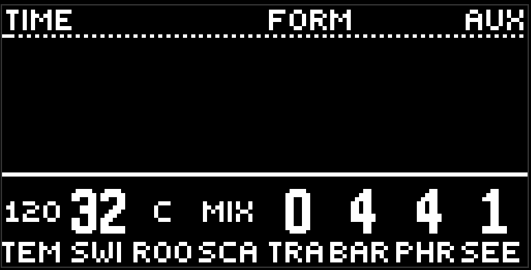

# Общие

вторая страница фиолетовой кнопки, шапка GLOBAL, группы TIME и FORM. настройки всего проекта. в сцену не пишутся, морфом не едут.

- **tempo** - 40..240. ручка медленная, чтобы попасть в число.
- **swing** - 0 прямой. выше нечётные шестнадцатые задерживаются, на максимуме на половину шестнадцатой.
- **root** - тоника. клетка показывает имя ноты: C, C#, D...
- **scale** - лад. в клетке MIN, MAJ, DOR, MIX, при касании полное имя в шапке.
- **trans** - транспонирование, ±24 полутона.
- **bar** - долей в такте, 1..16. метр для всего: переходов, длины аккордов, сетки деки.
- **phrase** - длина фразы в тактах, 1..64. столько ходит прогрессия, прежде чем вернуться.
- **seed** - зерно, 0..999. все вероятности считаются от него: тот же seed - тот же рисунок пропусков. крутаните, если грув "застрял" на одном варианте.

## Что из этого слышно сразу

всё. темп и свинг подхватываются на ходу без остановки транспорта, тоника и лад переписывают высоту нот при следующем взятии, seed меняет броски вероятности на следующем круге.

## Рандомизатор и delete

эта страница участвует в рандомизаторе как обычные values: depth all и values её двигают, generators не трогает. delete в рандомизаторе с scope page на этой странице вернёт всё к заводу - включая темп. имейте в виду.

[Руководство](README.md)
