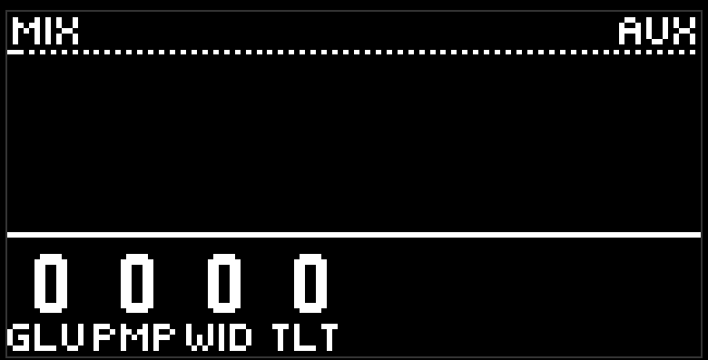
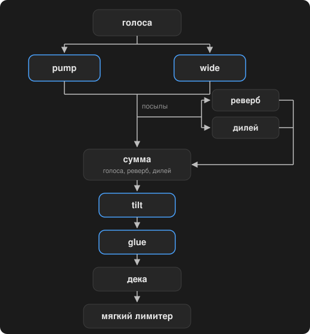

# Микс

четвёртая страница фиолетовой кнопки, синий пэд, шапка MIX. четыре ручки на выходной шине проекта: glue, pump, wide, tilt. ноль на всех четырёх - провод, сумма идёт как есть.

это не часть паттерна: record не пишет, морф не скользит. это звук вашего проекта поверх любой сцены.

- **glue** - компрессор на сумме. атака около 15 мс, отпуск около 150 мс; с ручкой растут и степень, и порог, плюс немного makeup. собирает плотность.
- **pump** - сайдчейн от кика: бас и аккорды притапливаются на каждый удар бочки и возвращаются за восьмую текущего темпа.
- **wide** - раскидывает тоны аккорда по стерео от нижнего к верхнему, раскрывает уже стоящую панораму хэта и даёт лиду и перку короткую задержку одного канала. кик, бас и снейр остаются в центре.
- **tilt** - один наклон на всей сумме, стык около 1 кГц: влево темнее, вправо ярче.

порядок в цепи. дека — страница [dj fx](dj-fx.md).

## Советы

- glue около 30 и pump около 40 - уже "клубный" характер без лишних движений.
- wide держите умеренно: моносумма остаётся честной, но на наушниках легко переборщить.
- tilt - быстрый способ подогнать общую яркость под колонки, не трогая фильтры дорожек.

[Руководство](README.md)
