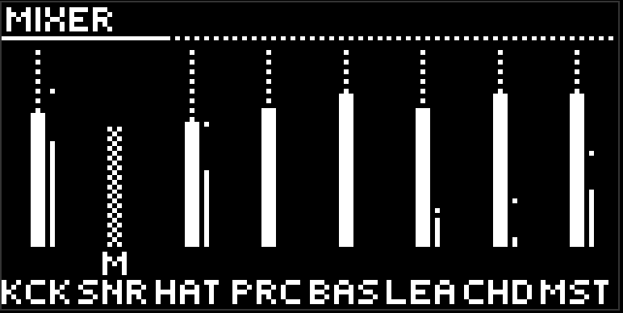
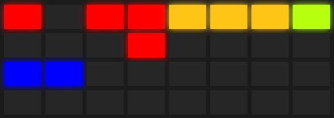

# Микшер

кнопка  **mute** открывает микшер. короткое нажатие оставляет его, долгое удержание - пока палец лежит, потом возврат туда, откуда зашли. пока микшер открыт, кнопка горит белым. нажатие любой кнопки дорожки закрывает защёлкнутый микшер.

микшер - режим, не страница: он забирает пэды и энкодеры целиком. джог здесь страницы не листает.

## Экран

восемь вертикальных фейдеров: семь дорожек и master. у fx фейдера нет - его громкость это ручки level на его страницах.

рядом с каждым фейдером полоска: уровень и пик. пик держится и падает. хвосты реверба и дилея видны только на мастере.

под фейдером буквы: `M` mute, `S` solo, `L` lock, в самом низу трёхбуквенный код дорожки. клетка поверх фейдера - дорожку сейчас не слышно: от своего mute или от чужого solo.

## Энкодеры

восемь энкодеров - восемь уровней. крутите. замьюченная дорожка не кормит ни реверб, ни дилей: тишина так тишина.

## Пэды

три верхних ряда по семь пэдов, слева направо как кнопки дорожек. восьмая колонка - fx.

- **верхний ряд - mute.** ярко, когда дорожку слышно, выключено, когда замьючена.
- **второй ряд - solo.** ярко только у включённого. несколько solo складываются; повтор снимает. пока есть хоть один solo, слышны только незамьюченные solo-дорожки. явный mute сильнее solo. у fx solo нет.
- **третий ряд - lock.** ярко у залоченной.

нижний ряд пуст. пэд в микшере сцену не запускает.

## Mute, solo, lock

**mute** убирает дорожку из выхода. замьюченные аккорды при этом продолжают кормить гармонией бас и лид. mute на fx глушит мокрый выход и оставляет ручки.

**solo** - временная история для настройки или перформанса. снятие последнего solo возвращает прежние mute как были.

**lock** - самый полезный флаг в moveless. залоченную дорожку не трогают морф, wander, рандомизатор и макросы. она ваша, пока вы не снимете lock. используйте его, чтобы зафиксировать фундамент и дать всему остальному гулять.

mute, solo, lock и уровни живут в проекте, не в сцене. они переживают любые переключения.

## Loop в микшере

кнопка  loop здесь рероллит уровни фейдеров по текущей силе рандомизатора. ни к чему не обязывает, иногда забавно.

[Руководство](README.md)
