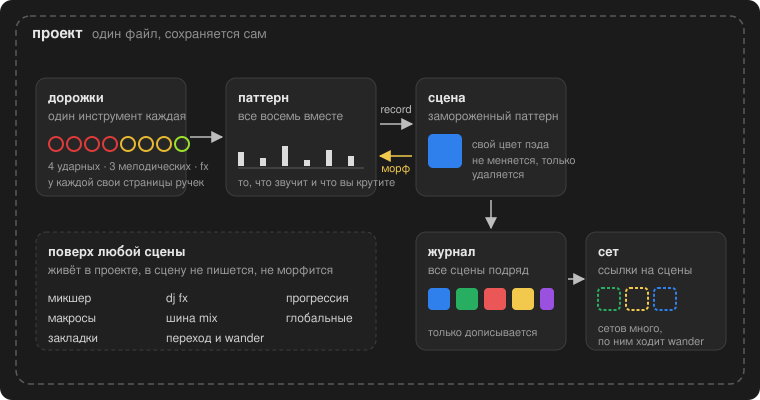
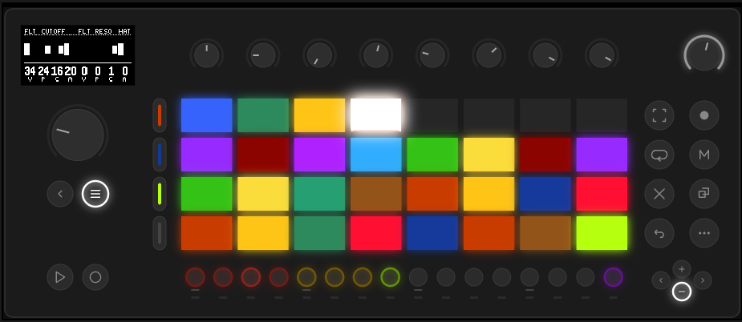

# Обзор системы

moveless - генеративный перформанс-секвенсер для Ableton Move. он не хранит ноты. он хранит правила, по которым ноты появляются, и вы играете этими правилами.

это глава для тех, кто хочет сначала понять картину целиком, а потом уже тыкать кнопки. если наоборот, идите сразу в [основы управления](basic-concepts.md), сюда можно вернуться позже.

## Из чего всё состоит

внутри moveless несколько слоёв, каждый лежит на предыдущем.

**дорожка** - один инструмент. их восемь: четыре ударных (kick, snare, hat, perc), три мелодических (bass, lead, chords) и одна дорожка эффектов (fx). у каждой дорожки свой набор ручек, разложенный по страницам.

**паттерн** - все восемь дорожек вместе. то, что играет прямо сейчас. то, что вы крутите, когда трогаете ручку. в коде это зовётся working, живой документ.

**сцена** - замороженный паттерн. вы нажали record, и текущий паттерн целиком лёг в память под своим цветом. сцену нельзя изменить, только удалить. это важно: вы никогда не испортите то, что уже записали.

**журнал** - все сцены подряд, от старой к новой. просто лента записей: на пэдах они лежат рядами, как кирпичи, от левого нижнего угла вверх.

**сет** - подборка ссылок на сцены из журнала. у вас может быть несколько сетов: один под живое выступление, другой под эксперименты. сцена в журнале одна, ссылок на неё может быть сколько угодно.

**морф** - переход от текущего паттерна к выбранной сцене. вы нажимаете пэд сцены, и ручки не прыгают, а едут к цели за заданное время. это и есть главный жест игры.

**проект** - всё вместе: журнал, сеты, микшер, глобальные настройки, закладки. один файл, который сам сохраняется и сам поднимается при включении.

## Как рождается звук

каждая дорожка играет по кругу петлю из шестнадцатых. где именно в этой петле стоят удары, решает евклидов генератор: длина кольца, число ударов, поворот, вероятность. у ударных и мелодических дорожек таких генератора два, они накладываются.

всё остальное - громкость, высота, длина ноты, тембр, фильтр, посылы - задаётся не числом, а огибающей. у ручки есть четыре части: значение, форма, цикл и глубина. значение - это центр, форма - рисунок, которым параметр гуляет вокруг центра, цикл - за сколько шестнадцатых рисунок повторяется, глубина - насколько далеко он отходит. глубина ноль - обычная ручка.

мелодические дорожки берут ноты из гаммы, а гамма и тоника лежат в общих настройках. поверх гаммы едет прогрессия аккордов. бас и лид могут слушать её (ручка follow), аккорды играют её напрямую.

дорожка fx - общий реверб и общий дилей. каждая дорожка посылает в них свою долю.

сумма проходит шину проекта (glue, pump, wide, tilt), потом деку dj fx, потом в выход.

## Как это играется

обычный цикл работы выглядит так.

1. выбрали дорожку, покрутили ручки. паттерн изменился сразу, вы его слышите.
2. понравилось - нажали record. в журнале появилась сцена своего цвета.
3. повторили несколько раз. в журнале несколько сцен.
4. нажали пэд одной из них. паттерн поехал к ней за время перехода.
5. нажали другую. поехал к другой.
6. включили wander. moveless сам ходит по сценам, вы только подруливаете.

между сценами живут ещё четыре инструмента перформанса, которые не записываются в сцену и не морфятся: микшер, макросы, dj fx и шина mix. они всегда поверх того, что играет.

## Что где на панели

снизу - ряд из шестнадцати степ-кнопок. первые восемь - дорожки. последняя, фиолетовая - настройки (aux). середина погашена.

в центре - 32 пэда. без пальца на джоге они показывают сцены. с пальцем на джоге - страницы выбранной дорожки и рандомизатор. в микшере и dj fx пэды забирают эти режимы.

над пэдами - восемь энкодеров. они крутят восемь колонок, которые вы видите внизу экрана.

экран - 128×64. сверху имя дорожки и страницы, под ним тонкая линия, дальше картинка петли, внизу восемь колонок с цифрами.

слева -  [menu](scenes.md) ([журнал/сет](scenes.md)), четыре  [track](bookmarks.md) ([закладки](bookmarks.md)),  [play](basic-concepts.md),  [record](scenes.md).

справа -  [capture](dj-fx.md) ([dj fx](dj-fx.md)),  [sample](transition.md) ([переход и wander](transition.md)),  [loop](randomize.md) ([рандомизация](randomize.md)),  [mute](mixer.md) ([микшер](mixer.md)),  [delete](scenes.md),  [copy](scenes.md),  [shift](basic-concepts.md).

джог - колесо: касание показывает страницы, поворот листает, клик защёлкивает рандомизатор.

подробнее про каждый жест - в [основах управления](basic-concepts.md).

## Что moveless не делает

чтобы не искать того, чего нет.

- нет пиано-ролла и шаг-секвенсера. ноты не вводятся руками.
- нет сэмплов. все голоса синтезированы внутри.
- нет своего таймлайна или аранжировки. структура трека - это вы и сцены.
- сцена не редактируется. записали новую - старая осталась как была.
- макросы, микшер, dj fx и шина mix не пишутся в сцену и не морфятся.

[Руководство](README.md)
