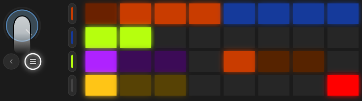

# Рандомизатор

кнопка  **loop** - один бросок: ручки в выбранной зоне сдвигаются случайно, с выбранной силой. ещё раз - ещё бросок. страница не меняется, результат слышно сразу. меню для этого не нужно: кнопка берёт глубину, зону и силу с пэдов и с закрытым джогом.

что именно меняется и насколько, задают нижние два ряда. сами пэды бросок не делают, только запоминают выбор.

## Пэды

коснитесь джога. верхние два ряда - страницы дорожки, нижние два - настройки рандомизатора. клик джога защёлкивает этот вид, второй клик возвращает сцены. пока он защёлкнут, [ряд перехода](transition.md) не рисуется.

**третий ряд - глубина и зона.**

глубина, фиолетовые, слева:

<table>
<tr><td align="center"></td><td align="center"></td><td align="center"></td></tr>
<tr><td align="center">значения и рисунки огибающих</td><td align="center">только pattern, cycle и amount. значения стоят</td><td align="center">только значения, follow, скаляры и евклид. рисунки стоят</td></tr>
</table>

после пустого пэда зона, оранжевые:

<table>
<tr><td align="center"></td><td align="center"></td><td align="center"></td></tr>
<tr><td align="center">вся дорожка</td><td align="center">группа текущей страницы: паттерн, ноты, звук или фильтр и посылы. у fx обе страницы</td><td align="center">только ручки текущей страницы</td></tr>
</table>

**четвёртый ряд - сила, и delete в правом углу.**

жёлтые слева, красный пэд справа:

<table>
<tr><td align="center"></td><td align="center"></td><td align="center"></td><td></td><td align="center"></td></tr>
<tr><td align="center" colspan="3">сила</td><td></td><td align="center">одно нажатие возвращает выбранную зону к заводу. глубина та же, что у броска, при values cutoff встаёт на 50</td></tr>
</table>

выбранный пэд в каждой группе горит обычной яркостью, остальные тускло. нажатие любого из них на секунду пишет имя над выбором на экран: DEPTH над ALL, SCOPE над LANE, INTENSITY над LOW.

страницы в верхних рядах подсвечивают зону: те, что попадут под бросок, горят ярко, остальные тускло.

## Сила

у каждой ручки есть дом - заводское значение - и вес. бросок тянется к дому, а не к краю шкалы: шаг к дому дешёвый, шаг от дома втрое дороже. поэтому даже high редко уводит всё в хаос - скорее переставляет.

low может отдать весь бюджет одной ручке. med - не больше половины на одну. high - не больше трети, зато трогает многих.

## Где ещё работает loop

- на [микшере](mixer.md) - уровни фейдеров.
- на [деке](dj-fx.md) - ручки открытой группы.
- на страницах фиолетовой кнопки - прогрессия, глобальные, микс как обычные values. generators их не трогает.

залоченная дорожка под бросок не попадает.

## Советы

- values + page + low на странице beat gen - самый безопасный способ сдвинуть грув.
- generators + group + med на голубой группе sound - новый характер огибающих тембра при тех же нотах.
- не понравилось - нажмите пэд текущей сцены. морф вернёт всё за время перехода. на now - сразу.
- и наоборот: понравилось - record, пока не передумали.

[Руководство](README.md)
