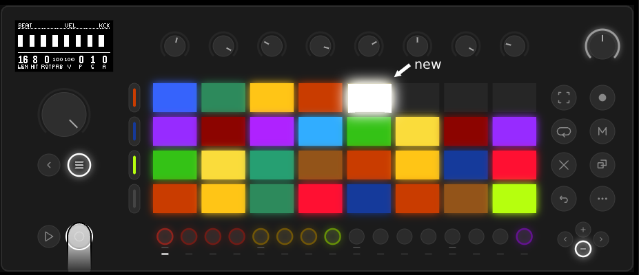
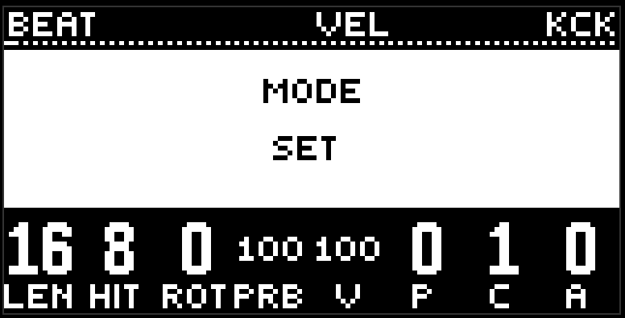
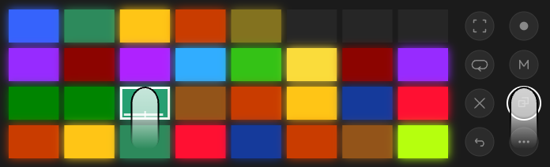

# Журнал и сеты

сцена - записанный паттерн. журнал - все сцены подряд. сет - подборка ссылок на сцены. это глава о том, как они появляются, раскладываются по пэдам и удаляются.

##  Record

нажали record (кружок рядом с play) - текущий паттерн целиком лёг в журнал новой сценой. record никогда не перезаписывает: каждое нажатие - новая сцена, со своим цветом из яркой палитры Move.

что входит в сцену: все восемь дорожек, включая fx. что не входит: прогрессия, глобальные настройки, макросы, микшер, шина mix, дека. это всё живёт в проекте и переживает смену сцен.

## Как лежат пэды

сцены ложатся как кирпичи. первый - в левом нижнем углу, следующие - правее в том же ряду. когда в ряду восемь, следующий начинает новый ряд над ним, снова слева. так что последняя записанная - всегда в самом верхнем из занятых рядов, крайняя справа.

в пустом журнале левый нижний пэд тускло пульсирует: это текущий, ещё не записанный паттерн, и первая сцена ляжет туда.

активная сцена пульсирует между своим цветом и белым. пустые пэды погашены.

на пэдах четыре ряда. пока рядов меньше, стена просто растёт снизу вверх. когда заполнены все четыре, окно сдвигается: в журнале верхний ряд - всегда незаконченный, по нему видно, куда встанет следующий кирпич. если в ряду уже восемь, сверху показывается пустой ряд, а три полных под ним.  **минус** спускается на четыре ряда старше, **плюс** поднимается обратно к новым. кнопка горит белым только если страница в ту сторону есть. самая старая страница всегда начинается с первого кирпича в левом нижнем углу, поэтому может частично повторять соседнюю.

сет лежит так же, но страниц у него нет: 32 ссылки - ровно четыре ряда снизу доверху.

## Журнал и сет

кнопка  **menu** (под джогом) переключает пэды между журналом и сетом. в журнале она горит белым, в сете погашена. смена режима на полсекунды показывает его имя на экране.

журнал один. сетов много: в режиме сета плюс переходит к следующему, минус к предыдущему, и в хвосте всегда есть один пустой - в него и пишете новый. направление то же, что в журнале: плюс к новому, минус к старому. в сете до 32 ссылок.

record в режиме сета делает две вещи: пишет сцену в журнал и сразу кладёт ссылку на неё в текущий сет.

##  Copy

copy собирает сцены в сет.

зажмите copy и нажимайте пэды в журнале - каждый отмечается зелёной пульсацией. нажатие пэда под copy сцену не запускает. отпустили - метки остались в буфере, пэды снова горят своим цветом. новое долгое нажатие copy начинает список заново.

переключитесь в сет и коротко нажмите copy - отмеченные легли в текущий сет, сколько влезло. уже лежащие пропускаются.

долгое copy в сете тоже помечает ссылки - так можно перенести подборку из одного сета в другой.

##  Delete

delete всегда вместе с чем-то.

- **delete + пэд в сете** - убрать ссылку из текущего сета. сцена в журнале остаётся.
- **delete + пэд в журнале** - удалить сцену насовсем, вместе со всеми ссылками на неё во всех сетах.
- **delete + минус** в режиме сета - удалить сам сет.
- **delete + кнопка дорожки** - вернуть дорожку к заводу. это не про сцены, но жест тот же.

подтверждений нет. удержание delete и есть подтверждение.

## Wander и сеты

[wander](transition.md) ходит по текущему сету. если сет пустой - по журналу. так что сет - это ещё и программа для автопилота: положите в него только то, что должно звучать сегодня.

## Советы

- записывайте часто. сцены дешёвые, журнал листается, а удалить всегда успеете.
- один сет на трек, один на черновики. менять их - плюс и минус.
- пустой сет + wander = wander по всему журналу. иногда это ровно то, что надо.

[Руководство](README.md)
