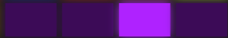

# Переход

нажатие пэда сцены не переключает паттерн, а морфит: живые ручки едут от того, что есть, к тому, что записано в сцене. переход - это сколько они едут. wander - автопилот, который сам нажимает пэды.

## Ряд перехода

нажмите  **sample**. вместо нижнего ряда сцен нижний ряд займут восемь пэдов: четыре жёлтых (переход) и четыре фиолетовых (wander). выбранный горит обычной яркостью, остальные тускло.

короткое нажатие sample оставляет ряд на месте, долгое удержание держит его, пока палец лежит. кнопка горит, пока ряд виден.

жёлтые, слева направо:

<table>
<tr><td align="center"></td><td align="center"></td><td align="center"></td><td align="center"></td></tr>
<tr><td align="center">0 тактов</td><td align="center">1 такт</td><td align="center">4 такта</td><td align="center">8 тактов</td></tr>
</table>

now не ждёт такта: все ручки прыгают на ближайшей шестнадцатой.

fast, medium и slow стартуют на следующем такте. now - на следующей шестнадцатой. если транспорт как раз на границе, старт сразу.

на экране при смене - крупно TRANSITION над SLOW, на полсекунды.

## Как едет морф

окно заданной длины - это переход между двумя фразами, не очередь ручек. дорожка, которая реально отличается, получает свой кусок окна и проходит его громкостью. рисунок, высота и тембр садятся одним разом внизу, когда дорожку не слышно. микшер не трогается: fade лежит поверх него и на посадке снова единица.

порядок ролей, ранние раньше: fx, хэт, перкуссия, малый, потом аккорды, потом лид, потом кик и бас одним стыком. на slow у каждой дороги свой кусок, не короче такта. на medium роли делят такты: цвет вместе, потом аккорды, лид, и в конце удар с басом. на fast окно однотактовое, поэтому две волны: первая половина - цвет и аккорды, вторая - лид, а кик с басом встречаются на последней доле. now без fade: всё на старте.

форма куска - dip, если дорога звучала и в цели тоже звучит. первая половина гаснет, в середине садится новая фраза, вторая половина проявляется. если дорога молчала и в цели заговорила - только fade in, фраза садится в начале куска с нуля. если в цели молчит - только fade out, внизу садится тишина и обратно не поднимается.

две вещи морф не трогает:

- **залоченная дорожка** стоит как стояла.
- **ручка, которую вы покрутили во время морфа**, остаётся вашей. морф снимает её с маршрута.

прогрессия, глобальные настройки, макросы, микшер и шина не морфятся - их в сцене нет.

## Wander

wander сам выбирает следующую сцену и запускает к ней переход. фиолетовые пэды:

<table>
<tr><td align="center"></td><td align="center"></td><td align="center"></td><td align="center"></td></tr>
<tr><td align="center">выключен</td><td align="center">2 такта паузы</td><td align="center">8 тактов</td><td align="center">16 тактов</td></tr>
</table>

пауза считается после посадки предыдущего перехода до старта следующего. сам переход идёт с текущей скоростью из жёлтого ряда. то есть slow + slow - восемь тактов едем, шестнадцать стоим.

откуда берёт сцены: из текущего [сета](scenes.md). если сет пустой - из журнала. предыдущую цель не повторяет.

и главное: wander не тащит всё. на каждом шаге каждая незалоченная дорожка выпадает в переход с шансом один к двум, молчащая - реже. если не выпала ни одна - берётся одна говорящая. выпавшие дороги делят всё окно перехода между собой, в том же порядке ролей, а не входят разом. так что результат - не ваши сцены по очереди, а их смесь, которой вы не записывали.
## Советы

- slow на переходе и slow на wander, залоченные кик и бас - фон на полчаса, который не надоедает.
- now - для живой игры сценами как клипами. записывайте сцены-вариации одного грува и бейте по пэдам.
- во время долгого морфа покрутите что-нибудь руками: это ваше, оно останется.

[Руководство](README.md)
