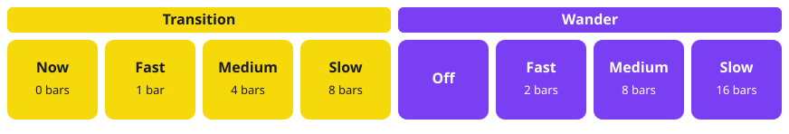

# Transition

A scene pad morphs the live pattern into that scene. Transition is how long the morph takes. Wander uses the same transition.

Sample puts this row on the bottom pads. The scene pads move up to make room. Transition is yellow. Wander is purple.

Fast, Medium, and Slow start on the next bar. Now starts on the next sixteenth. If the transport is already on that grid, the morph starts immediately.

A locked lane is left as it is. A knob turned during the morph keeps the value you set.

## Wander

Wander picks the next scene by itself and uses the current transition. It reads the active Set, or the Journal when that Set is empty.

[Guide](README.md)
